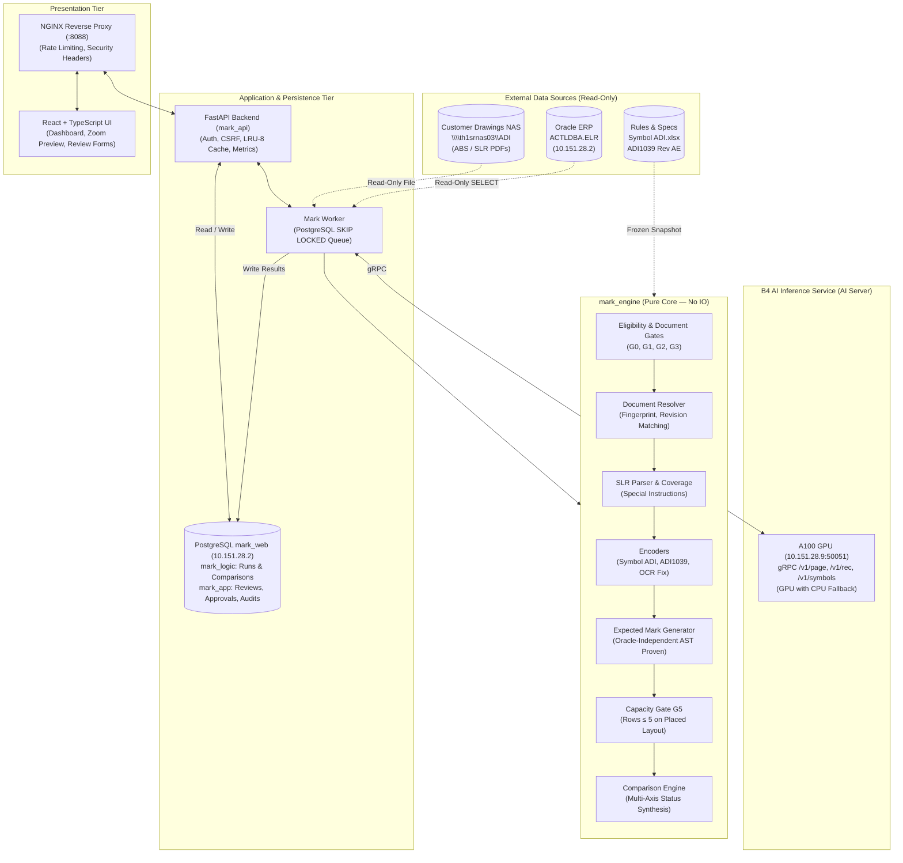
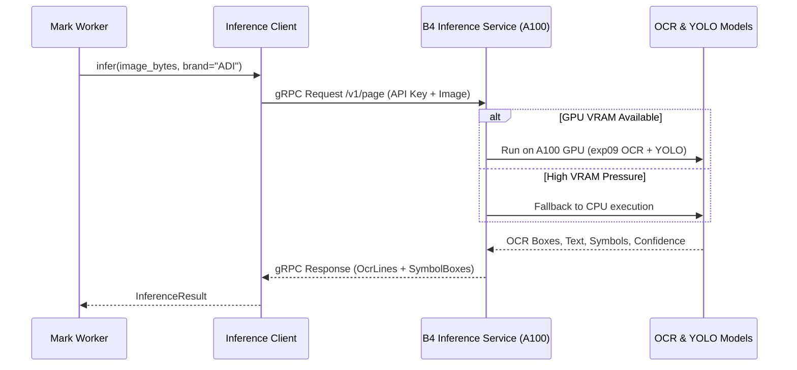

# System Architecture Specification (`architecture.md`)

> **System:** Mark Automation (`mark-web`) — Architecture V3  
> **Target Package:** `mark_engine` v0.4.0 · `mark_api` · B4 Inference Service  
> **Status:** Phase 1 Complete · Phase 2 Trial Active · Auto-Review B3/B4 In Progress

---

## 1. System Overview & Component Diagram

**Mark Automation** verifies semiconductor IC top and back markings by comparing expected markings—synthesized independently from customer drawings and specifications—against ERP lot records.

The architecture strictly follows the **Hexagonal / Ports & Adapters** paradigm:
- The **Domain Core (`mark_engine`)** is pure, deterministic, and free of side-effects. It has zero network, filesystem, or database I/O.
- The **Adapters & Services Tier** handles external interactions (Oracle ACTL, NAS filesystem, PostgreSQL, A100 GPU AI Server, and HTTP Web Clients).



---

## 2. Core Architectural Invariants

Every layer of the system must satisfy six foundational invariants:

### Invariant 1: Oracle Independence & Zero Data Leakage
The expected mark must be synthesized strictly from customer documentation without any visibility into Oracle's `TOP_MARK1..5` or `BACK_MARK1..5`.
- **AST Verification**: A static AST scanner (`tests/unit/test_generator_independence.py`) verifies that `generator.py` contains zero references to `OracleMark`, `TOP_MARK`, or `BACK_MARK`.
- **Dynamic Access Verification**: In test pipelines, an `OracleProxy` spy verifies that `OracleMark` fields cannot be accessed until `ExpectedMarkGenerator.generate()` has returned.
- **Independence Metric**: Verified at **100.0%** across all historical regression datasets.

### Invariant 2: Domain Immutability
All core domain models are defined as frozen dataclasses with slots:
```python
@dataclass(frozen=True, slots=True)
class ExpectedMark:
    lines: tuple[ExpectedLine, ...]
    source: str
    metadata: dict[str, str] = field(default_factory=dict)
```
Collections within domain structures must use `tuple` or `frozenset`. In-place mutations are disallowed.

### Invariant 3: Multi-Axis Classification (No "PASS" Status)
Because semiconductor quality verification involves multiple independent criteria, the system never reduces an outcome to a single "PASS" flag:
- `ProcessingStatus`: `DONE`, `HOLD`, `NOT_ELIGIBLE`, `FAILED`
- `VerificationStatus`: `MATCH_ALL`, `HAS_WARNING`, `HAS_DIFF`, `NOT_VERIFIABLE`
- `ApprovalStatus`: `PENDING_REVIEW`, `APPROVED`, `REJECTED`, `NOT_REQUIRED`
- `LineStatus`: `MATCH`, `MATCH_SLR`, `MATCH_SHIFT`, `MATCH_LOT`, `DIFF`, `NEEDS_REVIEW`, `NOT_MEASURABLE`

### Invariant 4: Dual-Document Requirement (Spec V2)
An ELR package requires both an ABS drawing and an SLR specification. If an SLR is absent, the engine immediately yields `HOLD:SLR_NOT_FOUND`, even if Oracle `CUST_REQ_NO` is blank or `N/A`.

### Invariant 5: Rule Precedence Hierarchy
When conflicting instructions exist across multiple documents, resolution follows a strict priority order (lower number takes precedence):
1. **Priority 10**: Special Lot Request (`SLR`) instructions
2. **Priority 20**: ELR Legend (`MARK_REMARK` / `MARK_REQUIRE`)
3. **Priority 30**: Customer Symbol Catalog (`Symbol ADI.xlsx`)
4. **Priority 40**: Standard Specifications (`ADI1039 Rev AE` — ABS and SLR only; raises `ValueError` on TRS)
5. **Priority 50**: Optical Character Recognition fix rules

### Invariant 6: Four-Mark Ground Truth Model
The system explicitly distinguishes 4 distinct mark values per line to prevent Oracle data from masquerading as ground truth:

| Value | Origin | Permitted Inputs | Ground Truth Role |
|---|---|---|---|
| `expected_mark` | `ExpectedMarkGenerator` | ABS, SLR, ADI1039, Symbol ADI, REMARK | Baseline algorithmic output |
| `oracle_mark` | Oracle ERP `ACTLDBA.ELR` | `TOP_MARK1..5`, `BACK_MARK1..5` | Target for comparison (NOT ground truth) |
| `engineer_corrected_mark`| Mark Engineer in Web UI | Manual engineer input on DIFF/WARNING lines | Human correction candidate |
| `engineer_verified_mark` | System upon formal approval | Equals corrected mark if present, else expected mark | **Sole ground truth for system accuracy** |

---

## 3. Subsystem Breakdown (`mark_engine`)

The `mark_engine` package is structured into functional modules:

```
mark_engine/
├── domain/             # Immutable data structures and typed enums
├── rules/              # RuleSet loader and rule registry
├── documents/          # Document locator, SHA256 fingerprinter, and resolver
├── abs/                # Marking page extraction, layout parser, and symbol mapper
├── slr/                # SLR section parser and coverage analyzer
├── encode/             # Token decoders (Symbol ADI, ADI1039, OCR fix, Remark)
├── generate/           # Expected mark generator and layout cell filler
├── compare/            # Line comparison engine, lot matching, shift matching
├── select.py           # Oracle eligibility and step selector
└── pipeline.py         # Main process_elr pipeline and G0–G5 gates
```

### 3.1 Document Resolution (`mark_engine/documents`)
- **`locator.py`**: Locates ELR folders on NAS, resolving complex naming schemes (standard folders, range folders like `ADI2603011-14`, and annotated folders).
- **`fingerprint.py`**: Computes SHA256 hashes of all files in the package and handles unzipping when necessary.
- **`classifier.py`**: Inspects PDF binary contents and headers to classify documents into `ABS`, `SLR`, `TRS`, or `OTHER`.
- **`resolve.py`**: Matches customer BOM revision with ABS drawing revisions. If multiple conflicting ABS revisions are found without BOM match, issues `HOLD:REVISION_CONFLICT`.

### 3.2 Optical Character Recognition & Symbol Mapping (`mark_engine/abs`)
- **`layout.py`**: Parses OCR bounding boxes into structured rows. Detects `LINE 1` to `LINE 7` labels.
- **`symbols_to_lines.py`**: Merges YOLO-detected symbols (e.g. pin1 dot, brand logos) into corresponding OCR text lines based on horizontal and vertical proximity.

### 3.3 Encoders & Rule Registries (`mark_engine/encode`)
- **`symbol_adi.py`**: Translates customer glyph tokens (`{1 Digit Date Code - LTC format}`) to Oracle placeholder representations using frozen tables (`symbol_adi_r0.json`).
- **`adi1039.py`**: Implements ADI1039 Rev AE rules. Enforces document scope: only permits application to ABS and SLR documents; raises `ValueError` if applied to TRS.
- **`ocr_fix.py`**: Corrects common optical misrecognitions (e.g., misreading `#` as `H` or `B` as `8` in specific package contexts).
- **`remark.py`**: Parses ELR header remarks (`MARK_REMARK`), identifying custom customer logos and skip-mark declarations.

### 3.4 Comparison Engine (`mark_engine/compare`)
Compares `ExpectedMark` against `OracleMark`:
- **`MATCH`**: Normalized expected string matches normalized Oracle string exactly, without stripping graphics.
- **`MATCH_SLR`**: Match is established via an explicit SLR override instruction.
- **`MATCH_LOT`**: Line contains lot placeholder (e.g. `XXXXXXX`) and the actual Oracle digits match the scheduled lot ID slice defined by ADI1039 Table 2.
- **`MATCH_SHIFT`**: Lines match following an allowed pin-dot line shift rule (`R06-SHIFT`).
- **`DIFF`**: Real discrepancy between customer specification and Oracle ERP.
- **`NEEDS_REVIEW`**: Ambiguous instruction or unverified digits requiring engineer review.

---

## 4. AI Inference Subsystem (B4 Service)

The AI inference layer offloads compute-heavy computer vision tasks to a remote GPU server.



### B4 Specifications
- **Host**: `10.151.28.9` (NVIDIA A100 80GB, CUDA 12.9, Docker 27.2).
- **Port**: `50051` (gRPC with TLS and API key authentication).
- **Fallback Policy**: Default execution is on GPU; if VRAM is constrained, seamlessly falls back to CPU execution.
- **Determinism Assertion**: CPU execution produces 0 diffs against run-19 regression baseline.

---

## 5. Web & API Tier (`services/api` & `web`)

### Backend Architecture (`mark_api`)
- **FastAPI Framework**: Modular routers for `auth`, `mark`, `validation`, `admin`, and `metrics`.
- **Session Authentication**: Cryptographic session tokens with `SameSite=Lax` cookies and custom header CSRF validation.
- **Brute-Force Protection**: Automatic account lockout after 5 consecutive failed attempts; rate-limiting at NGINX proxy (5 req/min on login).
- **LRU-8 Dashboard Cache**: In-memory `OrderedDict` caching up to 8 recent run views with automatic least-recently-used eviction.
- **NULL-Safe Serialization**: Custom `_text(v)` sanitizer ensures NULL database columns never trigger 500 crashes.
- **In-Process Metrics**: Ring buffers (`deque(maxlen=1000)`) tracking p50/p95 latency per endpoint, active sessions, and database errors.

### Frontend Architecture (`web`)
- **React 18 + TypeScript + Vite**: Responsive Single-Page Application (SPA).
- **State Management & Data Fetching**: Fast async fetchers with visual error banners and retry buttons.
- **Document Viewing**: Lazy-loaded ABS drawing thumbnails with modal pan-and-zoom inspection.
- **Review Forms**: Expandable inline review editors for ERROR/WARNING lines with reason code selection and note capture.

---

## 6. Network & Deployment Topology

| Host / Subnet | Role | Key Services & Ports | Security / Isolation |
|---|---|---|---|
| `10.151.28.2` | Database & ERP | PostgreSQL `:5432` (`mark_web`), Oracle `:1521` (`ACTLDBA`) | Password authentication in `.env` |
| `10.151.28.9` | AI Inference Server | A100 GPU, gRPC `:50051`, OCR legacy `:8095` | SSH key-based access (`id_ed25519_nopass`), API Key |
| `10.151.28.3` | Orchestration | Apache Airflow (`mark_elr_polling`) | Internal subnet |
| `10.153.90.17` | Production App Host | Docker Compose: NGINX `:8088`, API `:8000`, Web `:80` | Internal company network |
| `\\th1srnas03\ADI` | Customer NAS Storage | Windows SMB Share | Read-only mount |
