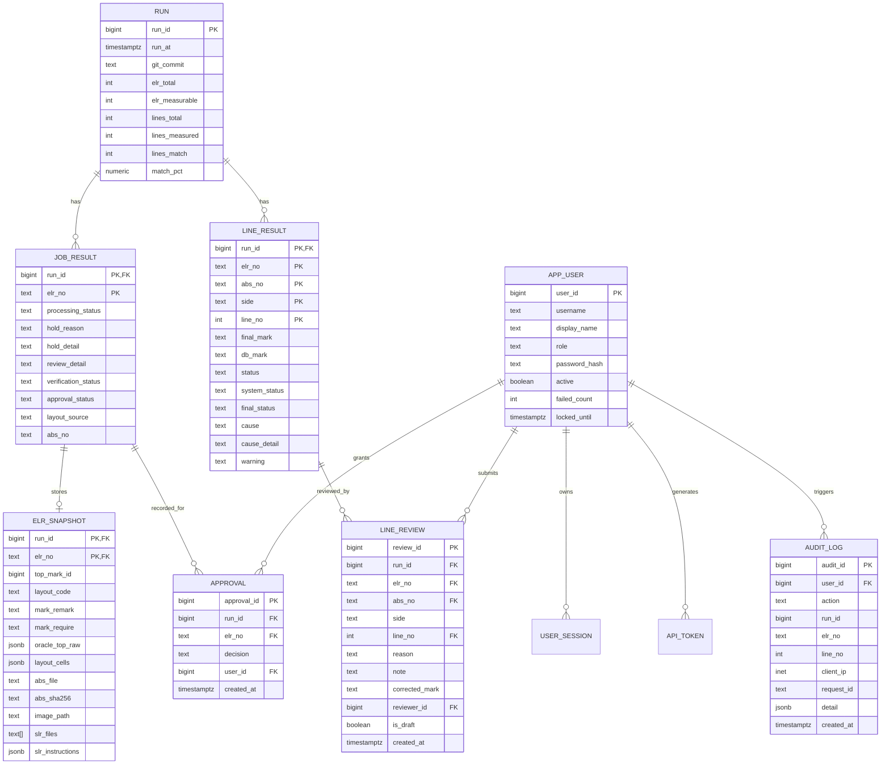

# Database Architecture & Specification (`database.md`)

> **Database System:** PostgreSQL 15+  
> **Host / Port:** `10.151.28.2:5432` | **Database Name:** `mark_web`  
> **Schemas:** `mark_logic` (Engine runs & legacy snapshots) · `mark_app` (Web application, users, reviews, approvals)

---

## 1. Overview & Connection Architecture

The `mark_web` database serves as the persistent ground-truth and collaboration store for the Mark Automation platform. It separates raw batch engine outputs from human review, auditing, and authentication:

- **`mark_logic` Schema**: Contains batch regression runs, line-by-line comparison outputs, rule catalogs, and historical snapshots. Engine runs insert new runs here via `scripts/load_r1_to_pg.py`.
- **`mark_app` Schema**: Contains web application state, user identities, session tokens, line-level human reviews, formal sign-offs/approvals, and immutable audit logs.



---

## 2. Migration Timeline & Current Status

Migrations are located in [`migrations/`](file:///D:/CIM%20Project/mark-web/migrations). Each migration is strictly separated into `-- UP` and `-- DOWN` transactions.

| Migration | Title / Scope | Target Schema | Status on `10.151.28.2` |
|---|---|---|:---:|
| `M0` | Baseline Snapshot & `pg_dump` | All | **Executed** (Frozen R0 snapshot) |
| `0001` | Role Provisioning & Privileges | `public`, `mark_logic` | Draft (Scheduled with production cutover) |
| `0002` | `mark_regression` Frozen Tables | `mark_regression` | Draft (Historical R0 freeze) |
| `0003` | `mark_rules` Governance & Provenance | `mark_rules` | Draft (Rule audit approval) |
| `0004` | Review Columns & `job_result` Table | `mark_logic` | **APPLIED (2026-11-05)** |
| `0005` | Trial Schema (`app_user`, `line_review`, `approval`, etc.) | `mark_app` | **APPLIED (2026-11-05)** |
| `0006` | Audit Context (`client_ip`, `request_id`, action index) | `mark_app` | **APPLIED (2026-11-05)** |

### Role Security Model
When `0001_roles.sql` is activated, database access adheres to the Principle of Least Privilege:
- **`mark_owner`**: Schema owner and migration administrator.
- **`mark_app`**: Service login used by FastAPI and background workers. Read/write on `mark_app.*`, read-only on `mark_logic.*`.
- **`mark_rules_admin`**: Rule governance role for Mark Engineering managers to approve rule updates.
- **`mark_readonly`**: Read-only reporting role for dashboards and BI.

---

## 3. Schema `mark_logic` — Table Reference

The `mark_logic` schema stores the results of batch regression runs and rule specifications.

### 3.1 `mark_logic.run`
Tracks each batch execution or regression run.

| Column | Type | Constraints | Description |
|---|---|---|---|
| `run_id` | `bigint` | `PRIMARY KEY GENERATED ALWAYS AS IDENTITY` | Unique sequential run ID |
| `run_at` | `timestamptz` | `NOT NULL DEFAULT now()` | Timestamp when the run was completed |
| `period` | `text` | | Dataset timeframe (e.g. `2026-01..2026-06` or `blind-2026h2`) |
| `git_commit` | `text` | | Commit SHA and branch of the code executed |
| `ocr_model` | `text` | | OCR model name and checkpoint |
| `symbol_model`| `text` | | YOLO symbol detection checkpoint |
| `elr_total` | `int` | | Total number of ELRs processed in this run |
| `elr_measurable`| `int` | | Total ELRs with measurable status (excluding HOLD/NOT_ELIGIBLE) |
| `lines_total` | `int` | | Total IC mark lines evaluated |
| `lines_measured`| `int` | | Total mark lines compared |
| `lines_match` | `int` | | Lines matching criteria (`MATCH*`) |
| `match_pct` | `numeric` | | Accuracy percentage: `(lines_match / lines_measured) * 100` |
| `lines_db_wrong`| `int` | | Lines confirmed by engineer where Oracle DB was wrong |
| `lines_diff` | `int` | | Discrepancies between expected mark and Oracle mark |
| `note` | `text` | | Descriptive notes about the run parameters |

### 3.2 `mark_logic.job_result`
Added in migration `0004`. Retains the top-level status of every ELR job in a run, preserving jobs that halted during document resolution or gate checks.

| Column | Type | Constraints | Description |
|---|---|---|---|
| `run_id` | `bigint` | `REFERENCES mark_logic.run(run_id) ON DELETE CASCADE` | Associated run |
| `elr_no` | `text` | `NOT NULL` | Engineering Lot Request identifier |
| `processing_status`| `text` | `NOT NULL` | `DONE` \| `HOLD` \| `NOT_ELIGIBLE` \| `FAILED` |
| `hold_reason` | `text` | | Reason code if on HOLD (`CUST_ASSY_TBD`, `ABS_NOT_FOUND`, `SLR_NOT_FOUND`, `ROW_OVER_5`, etc.) |
| `hold_detail` | `text` | | Detailed explanation or diagnostic message |
| `review_detail` | `text` | | Flag for human attention (`RULE_CONFLICT`, `REVISION_MISMATCH`) |
| `verification_status`| `text` | | Multi-axis verdict (`MATCH_ALL`, `HAS_WARNING`, `HAS_DIFF`, `NOT_VERIFIABLE`) |
| `approval_status` | `text` | | `PENDING_REVIEW`, `APPROVED`, `REJECTED`, `NOT_REQUIRED` |
| `layout_source` | `text` | | Document or template from which the marking layout was derived |
| `abs_no` | `text` | | Resolved ABS base drawing number (`ABS\d{6}`) |

*Primary Key:* `(run_id, elr_no)`

### 3.3 `mark_logic.line_result`
Line-by-line mark comparison details between Expected Mark and Oracle ERP.

| Column | Type | Constraints | Description |
|---|---|---|---|
| `run_id` | `bigint` | `REFERENCES mark_logic.run(run_id) ON DELETE CASCADE` | Associated run |
| `elr_no` | `text` | `NOT NULL` | ELR number |
| `abs_no` | `text` | `NOT NULL` | Standardized base ABS number (`ABS\d{6}`) |
| `side` | `text` | `NOT NULL` | `TOP` or `BACK` |
| `line_no` | `int` | `NOT NULL` | Mark line number (1 to 5) |
| `final_mark` | `text` | | System-generated expected mark text |
| `db_mark` | `text` | | Oracle ERP value (`TOP_MARK1..5`) |
| `status` | `text` | | Effective comparison status (includes human verdict in older runs) |
| `system_status` | `text` | Added M0004 | Pure algorithm comparison status (unaffected by human overrides) |
| `final_status` | `text` | Added M0004 | Human-adjudicated status (`DB_WRONG`, `HUMAN_FIXED`, or system status) |
| `cause` | `text` | | Primary root cause classification |
| `cause_detail` | `text` | | Structured diagnostic string with rule tags and flags |
| `warning` | `text` | Added M0004 | Non-blocking warning (e.g. `COO_ABBREVIATED`) |
| `hold_detail` | `text` | Added M0004 | Inherited hold explanation if line is not measurable |
| `review_detail` | `text` | Added M0004 | Detailed reason if flagged `NEEDS_REVIEW` |
| `layout_source` | `text` | Added M0004 | Cell source on layout |

*Primary Key:* `(run_id, elr_no, abs_no, side, line_no)`

### 3.4 Auxiliary Reference Tables in `mark_logic`
- **`status_dictionary`**: Enumeration of comparison statuses (`MATCH`, `MATCH_SLR`, `MATCH_SHIFT`, `MATCH_LOT`, `DB_WRONG`, `DIFF`, `NEEDS_REVIEW`, `HUMAN_FIXED`, `NOT_MEASURABLE`, `NOT_ELIGIBLE`).
- **`logic_rule`**: Catalog of 44 transformation and comparison rules (snapshot `RV-2026-11-04-R0.json`).
- **`symbol_profile`**: Customer symbol mappings derived from `Symbol ADI.xlsx`.
- **`encoder_alias`**: Token aliases mapping drawing glyphs to Symbol ADI names.
- **`adi1039_token`**: ADI1039 Rev AE token definitions and lot slicing rules.
- **`adi1039_code`**: Lookup codes for wafer IDs, date codes, and die positions.

---

## 4. Schema `mark_app` — Table Reference

The `mark_app` schema supports the web application, user security, line reviews, and formal approvals.

### 4.1 `mark_app.app_user`
User credentials and account lockout management.

| Column | Type | Constraints | Description |
|---|---|---|---|
| `user_id` | `bigint` | `PRIMARY KEY GENERATED ALWAYS AS IDENTITY` | Internal user ID |
| `username` | `text` | `NOT NULL UNIQUE (lower)` | Unique login username |
| `display_name` | `text` | `NOT NULL` | Human-readable full name |
| `role` | `text` | `CHECK (role IN ('engineer', 'mark_eng_approver', 'admin'))` | Security role |
| `password_hash` | `text` | `NOT NULL` | Argon2id / PBKDF2 password hash |
| `active` | `boolean`| `NOT NULL DEFAULT true` | Account active flag |
| `failed_count` | `int` | `NOT NULL DEFAULT 0` | Consecutive failed login counter |
| `locked_until` | `timestamptz` | | Lockout expiration timestamp (triggers after 5 failed attempts) |
| `created_at` | `timestamptz` | `NOT NULL DEFAULT now()` | Registration timestamp |

### 4.2 `mark_app.user_session`
Server-side active sessions.

| Column | Type | Constraints | Description |
|---|---|---|---|
| `token_hash` | `text` | `PRIMARY KEY` | SHA256 of session bearer token |
| `user_id` | `bigint` | `REFERENCES mark_app.app_user(user_id) ON DELETE CASCADE` | Authenticated user |
| `csrf_hash` | `text` | `NOT NULL` | SHA256 of CSRF token |
| `expires_at` | `timestamptz`| `NOT NULL` | Session timeout timestamp |
| `last_seen_at` | `timestamptz`| `NOT NULL DEFAULT now()` | Sliding activity timestamp |
| `created_at` | `timestamptz`| `NOT NULL DEFAULT now()` | Session creation timestamp |

### 4.3 `mark_app.elr_snapshot`
Caches complete contextual metadata for an ELR to enable rich UI rendering without live ERP queries.

| Column | Type | Constraints | Description |
|---|---|---|---|
| `run_id` | `bigint` | `FK -> mark_logic.job_result(run_id, elr_no)` | Associated run |
| `elr_no` | `text` | `FK -> mark_logic.job_result(run_id, elr_no)` | Associated ELR |
| `top_mark_id` | `bigint` | | Layout template ID |
| `layout_code` | `text` | | Layout code (e.g. `ZY`) |
| `mark_remark` | `text` | | ELR legend / special remarks |
| `mark_require` | `text` | | Special customer marking requirements |
| `top_template_remark`| `text` | | Template remark |
| `oracle_top_raw`| `jsonb` | | Raw Oracle `TOP_MARK1..5` strings |
| `layout_cells` | `jsonb` | | Fixed and dynamic cell placements |
| `abs_file` | `text` | | Base filename of resolved ABS PDF |
| `abs_sha256` | `text` | | SHA256 fingerprint of ABS PDF |
| `image_path` | `text` | | Relative path to extracted brand page PNG |
| `slr_files` | `text[]` | | List of resolved SLR filenames |
| `slr_instructions`| `jsonb` | | Structured parsed instructions from SLR |
| `import_date` | `timestamptz`| `NOT NULL DEFAULT now()` | Ingestion timestamp |

*Primary Key:* `(run_id, elr_no)`

### 4.4 `mark_app.line_review`
Records Mark Engineer review decisions and corrections on discrepant or unverified lines.

| Column | Type | Constraints | Description |
|---|---|---|---|
| `review_id` | `bigint` | `PRIMARY KEY GENERATED ALWAYS AS IDENTITY` | Unique review event ID |
| `run_id` | `bigint` | `NOT NULL` | Target run ID |
| `elr_no` | `text` | `NOT NULL` | Target ELR number |
| `abs_no` | `text` | `NOT NULL` | Target base ABS number (`ABS\d{6}`) |
| `side` | `text` | `NOT NULL CHECK (side = 'TOP')` | Marking side |
| `line_no` | `int` | `NOT NULL` | Line number (1–5) |
| `reason` | `text` | `CHECK (reason IN ('DB_WRONG', 'OCR_WRONG', 'SYMBOL_WRONG', 'SLR_ECN_CHANGE', 'RULE_MISSING', 'LAYOUT_WRONG', 'OTHER'))` | Root cause selected by engineer |
| `note` | `text` | | Free-text technical justification |
| `corrected_mark`| `text`| | Corrected string provided by engineer |
| `reviewer_id` | `bigint` | `REFERENCES mark_app.app_user(user_id)` | Reviewer user ID |
| `is_draft` | `boolean`| `NOT NULL DEFAULT false` | Draft or committed flag |
| `created_at` | `timestamptz` | `NOT NULL DEFAULT now()` | Review submission timestamp |

*Foreign Key:* `(run_id, elr_no, abs_no, side, line_no)` references `mark_logic.line_result`.

> **Critical FK Rule**: The foreign key points to `mark_logic.line_result` which stores normalized `abs_no` (e.g. `ABS071169`), NOT the raw filename stem (`ABS071169-ENG-2`). Routers must look up `abs_no` from `line_result`.

### 4.5 `mark_app.approval`
Formal sign-off on an ELR marking specification.

| Column | Type | Constraints | Description |
|---|---|---|---|
| `approval_id` | `bigint` | `PRIMARY KEY GENERATED ALWAYS AS IDENTITY` | Unique approval ID |
| `run_id` | `bigint` | `NOT NULL` | Target run |
| `elr_no` | `text` | `NOT NULL` | Target ELR |
| `decision` | `text` | `NOT NULL CHECK (decision IN ('APPROVED', 'REJECTED'))` | Approval outcome |
| `user_id` | `bigint` | `REFERENCES mark_app.app_user(user_id)` | Approver user ID |
| `created_at` | `timestamptz` | `NOT NULL DEFAULT now()` | Decision timestamp |

*Foreign Key:* `(run_id, elr_no)` references `mark_logic.job_result(run_id, elr_no)`.

### 4.6 `mark_app.audit_log`
Immutable tamper-evident security audit trail (enhanced in migration `0006`).

| Column | Type | Constraints | Description |
|---|---|---|---|
| `audit_id` | `bigint` | `PRIMARY KEY GENERATED ALWAYS AS IDENTITY` | Sequential event ID |
| `user_id` | `bigint` | `REFERENCES mark_app.app_user(user_id)` | Acting user (NULL for anonymous login attempts) |
| `action` | `text` | `NOT NULL` | Action code (`auth.login_ok`, `auth.login_failed`, `review.saved`, `approval.saved`, `admin.unlock`) |
| `run_id` | `bigint` | | Associated run ID (if applicable) |
| `elr_no` | `text` | | Associated ELR (if applicable) |
| `line_no` | `int` | | Associated line number (if applicable) |
| `client_ip` | `inet` | Added M0006 | Client IP address from HTTP request / proxy headers |
| `request_id` | `text` | Added M0006 | Unique correlation ID (`X-Request-ID`) |
| `detail` | `jsonb` | | Structured event payload (e.g. failure reason, attempt counts, prior state) |
| `created_at` | `timestamptz` | `NOT NULL DEFAULT now()` | Timestamp |

---

## 5. JSONB Data Structures

### `mark_app.elr_snapshot.oracle_top_raw`
Stores raw Oracle text fields exactly as returned from `ACTLDBA.ELR`:
```json
{
  "TOP_MARK1": "ADG884",
  "TOP_MARK2": "BCPZ",
  "TOP_MARK3": "#2432",
  "TOP_MARK4": "0.4",
  "TOP_MARK5": "1234567.1"
}
```

### `mark_app.elr_snapshot.slr_instructions`
Structured representations of rules extracted from the SLR PDF:
```json
[
  {
    "side": "TOP",
    "line_no": 3,
    "text": "#YYWW",
    "rule": "SPECIAL_INSTRUCTION",
    "source_text": "Line 3: Mark # followed by 4 digit date code"
  }
]
```

### `mark_app.audit_log.detail`
Example audit log payloads:
```json
// Login failure
{
  "reason": "bad_password",
  "username": "qa_engineer",
  "consecutive_failures": 3
}

// Line Review saved
{
  "line_no": 4,
  "reason": "DB_WRONG",
  "corrected_mark": "0.4",
  "note": "Oracle omitted decimal point per customer drawing ABS071169"
}
```

---

## 6. Data Integrity & Operational Invariants

1. **Immutable History**: Runs 1 through 3 (R0 baseline) and Run 14 (R1 baseline) are frozen. Modifying past runs is strictly forbidden.
2. **Deterministic Regeneration**: When a job is re-evaluated, it must be inserted under a **new `run_id`**. Prior run data remains completely intact for audits.
3. **Approval Prerequisite**: An ELR cannot be approved if any line with `final_status = ERROR` remains unreviewed. Submitting an approval in this state returns HTTP `409 Conflict`.
4. **Cascade Guarantees**: Deleting a temporary test run from `mark_logic.run` cascades cleanly to `job_result` and `line_result`.
