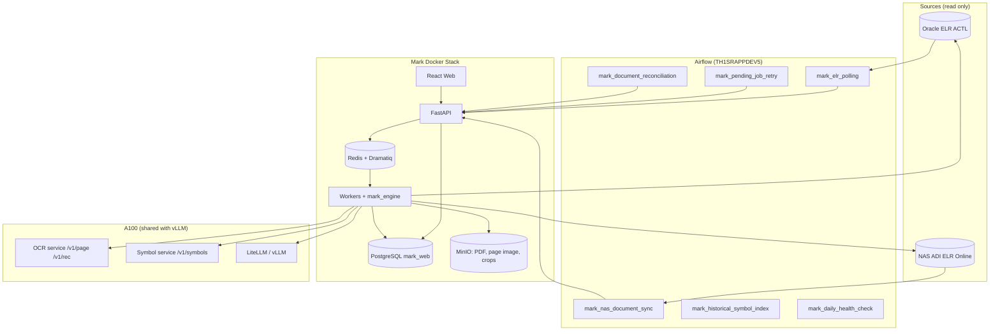
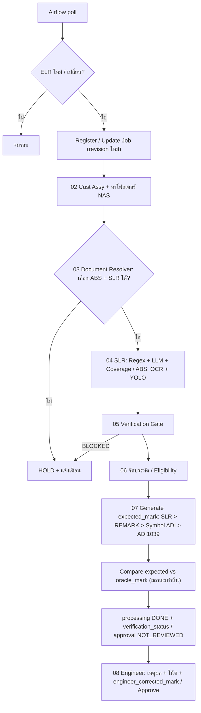

# Mark Automation — แบบออกแบบระบบ (Design)

วันที่: 2026-11-04 · ผู้รีวิว: เจ้าของโปรเจกต์ (Kam) · สถานะ: ร่าง v3 — แก้ตามรีวิว P0/P1 + ข้อมูล Oracle/ADI1039 เพิ่มเติม (2026-11-04)
ที่มาของข้อมูลและผลทดสอบ: repo `D:\CIM Project\mark` (`experiments/abs_vs_db/`, `experiments/symbol_det/`, `deploy/`)
และ PostgreSQL `mark_web` schema `mark_logic` (สร้าง 2026-11-04)

> สัญลักษณ์ในเอกสาร: **[ผู้ใช้]** = สิ่งที่เจ้าของโปรเจกต์กำหนด · **[ผลทดสอบ]** = มาจากการทดลองจริง ม.ค.–มิ.ย. 2026 ·
> **[Claude]** = การตัดสินใจของผู้เขียน รอรีวิว

---

## 1. ระบบนี้ทำเพื่ออะไร

ตรวจ Brand/Marking ของ ELR ลูกค้า ADI **ก่อนเข้าไลน์ผลิต** โดยอ่านเอกสารที่ ADI ส่งมา (ABS = Marking Specification,
SLR = Special Lot Request) แล้วสร้าง "Mark ที่ควรเป็น" รายบรรทัด เทียบกับค่าที่ Mark Engineer คีย์ไว้ใน Oracle ELR
(TOP_MARK1–5, BACK_MARK1–5) เพื่อจับการคีย์ผิดก่อนผลิต

ระบบทำงานเบื้องหลังตลอดเวลา: เมื่อ ELR เข้าขั้น **Mark Eng Review** ระบบประมวลผลไว้ก่อน แล้ว Engineer เปิดเว็บมาเห็น
Preview ทันที ไม่ต้องรอ AI อ่าน PDF ทุกครั้ง **[ผู้ใช้]**

ลำดับตรรกะหลัก **[ผู้ใช้]**:

```
ABS ──> OCR + YOLO ──> Encode ด้วย Symbol ADI + SLR + ELR MARK_REMARK (Oracle ACTL) ──> เทียบ Oracle ──> Preview ──> User Review
```

**หลักการแยก 3 ค่า (รีวิว P0-1)** — ทุกบรรทัดมีค่าแยกกันเสมอ ไม่ปนกัน:

| ค่า | สร้างจาก | ห้าม |
|---|---|---|
| `expected_mark` | ABS + SLR + spec (ADI1039, Symbol ADI) + MARK_REMARK ผ่านกฎ `rule_stage = generate` เท่านั้น | ห้ามอ่าน TOP/BACK_MARK ของ Oracle |
| `oracle_mark` | TOP/BACK_MARK ใน Oracle ณ เวลาประมวลผล (snapshot) | ห้ามใช้ปรับ expected_mark |
| `engineer_corrected_mark` | ค่าที่ถูกต้องที่ Engineer กรอกตอนรีวิว | — |

การเทียบ (`rule_stage = compare`) ให้ "สถานะ" เท่านั้น เช่น MATCH_LOT/MATCH_SHIFT ไม่แก้ expected_mark
วัดผล 2 แกนแยกกัน: **Oracle agreement** (expected vs oracle) และ **Correctness** (expected vs engineer_corrected)

## 2. เป้าหมาย / ไม่ทำ / ห้ามเกิด

**เป้าหมาย**
- Draft Mark Result พร้อมก่อน Engineer เปิดงาน (proactive background processing) **[ผู้ใช้]**
- **False PASS = 0**: ไม่มีบรรทัดที่ระบบบอกตรง แต่ Engineer GT บอกผิด — ตัวชี้วัดหลัก (ข้อ 18)
- ตัวชี้วัดอื่นแยกรายงาน: Coverage, Hold Rate, Oracle agreement, Correctness บน **blind test** (ข้อ 18)
- หมายเหตุ: 98.5% (1,747/1,773, run_id 3 หลังใช้กติกา Type E + SLR ตาม CUST_REQ_NO; ก่อนหน้า 98.7% = 1,956/1,982) เป็น **Oracle agreement บนชุดที่ใช้ปรับกฎเอง** (ม.ค.–มิ.ย. 2026) ไม่ใช่ production accuracy (รีวิว P0-4)
- ทุกบรรทัดที่ไม่ตรง Engineer ใส่ **เหตุผล (ตัวเลือกคงที่) + โน้ตอิสระ + ค่าที่ถูกต้อง** เพื่อพัฒนาระบบต่อ **[ผู้ใช้]**
- ทุกผลมีหลักฐานย้อนกลับได้: ไฟล์, หน้า, bbox, score, กฎที่ใช้, เวอร์ชันโมเดลและกฎ

**ไม่ทำในเฟสนี้**
- ไม่เขียนกลับ Oracle ELR ไม่ว่ากรณีใด (อ่านอย่างเดียว) **[ผู้ใช้]**
- ไม่ทำ Grafana / dashboard monitoring **[ผู้ใช้]**
- ลูกค้าอื่นนอกจาก ADI, การเทียบ PT **[Claude]**
- ไม่เทรนโมเดลอัตโนมัติ (เก็บข้อมูลเทรนไว้ เทรนด้วยคนตามรอบ) **[Claude]**

**ห้ามเกิด (anti-goals)**
- งานที่ตรวจไม่ครบ (ขาด SLR, ข้ามขั้น, เอกสารเปลี่ยนแล้ว, ข้อความ SLR ที่ตีความไม่ได้) ถูกแสดงว่าตรง — ต้องเป็น HOLD / NEEDS_REVIEW / NOT_VERIFIABLE เสมอ
- ระบบ "เรียนรู้" ให้ตรง Oracle แทนที่จะตรง ABS/SLR — กฎที่ได้จากการดู Oracle (`rule_origin = oracle_derived`) ต้องผ่าน Mark Eng ก่อนใช้
- Frontend/API ตีความ "ตรง Oracle" ว่า "อนุมัติแล้ว" — สถานะแยก 3 แกน (ข้อ 6.1)
- กฎหนึ่งทับอีกกฎเงียบ ๆ (เช่น ADI1039 ทับคำสั่ง SLR) — ขัดกันต้องเป็น NEEDS_REVIEW
- LLM เห็นค่าใน Oracle แล้ว "ลอก" คำตอบ — LLM ห้ามได้รับค่า TOP/BACK_MARK
- ผลจาก LLM ถูกนับว่าผ่านโดยไม่มีคนดู — ข้อเสนอจาก LLM เป็น REVIEW เสมอ **[ผู้ใช้]**
- Approve Draft ที่เอกสาร/ELR เปลี่ยนไปแล้ว (stale) **[ผู้ใช้]**

## 3. สภาพปัจจุบัน (สิ่งที่มีแล้ว)

รายละเอียดเต็ม (ฐานข้อมูล, คอลัมน์, โมเดล, ไฟล์, ค่าวัดผล, เซิร์ฟเวอร์) อยู่ใน **ภาคผนวก A** ท้ายเอกสาร

| ของที่มี | ที่อยู่ | หมายเหตุ |
|---|---|---|
| OCR recognition EXP09 (PP-OCRv5_server_rec ep40) | `mark/deploy/model/`, container `ic-marking-ocr:exp09` port 8095 บน A100 (CPU) | CER 0.62% benchmark, 1.00% เม.ย. |
| Text detection PP-OCRv5_server_det | ดาวน์โหลด pretrained, `enable_mkldnn=False` (bug oneDNN paddle 3.3 CPU) | ใช้ใน `det_rec_server.py` |
| YOLOv8n `symdet_v2` | A100 `~/ic_marking_symdet/runs/symdet_v2/weights/best.pt` | class: pin1_dot, adi_partial_logo, adi_full_logo (ยังไม่มีข้อมูลเทรน) |
| ตัวดึงหน้า Brand จาก ABS | `extract_marking_images.py` | หน้าสุดท้ายที่มีคำว่า "Brand/Marking" |
| จัดบรรทัด | `build_h1.py`, `graphics_to_lines.py` | ป้าย L/Line, TOP/BOTTOM, ตาราง LINE n:, ป้ายอยู่ขวา |
| Encoder + กฎ + เทียบ DB | `build_compare.py`, `mapping_gap_analysis.py` | สคริปต์ batch ผูกกับช่วง ม.ค.–มิ.ย. |
| อ่านซ้ำ | `reocr.py` | ตัดโลโก้ / ครอปหลัง `LINE n:` |
| กฎและสถิติ | PostgreSQL `mark_web.mark_logic` (13 ตาราง) | `export_logic_pg.py` |
| หน้ารีวิว | `diff_review.html`, `review.html` | export CSV → `review/` |

ผลทดสอบสะสมรายขั้น (encoder ก่อน) **[ผลทดสอบ]**: OCR+Symbol ADI 60.5% → +ADI1039 71.0% → +YOLO 81.7% → +SLR 87.4%
→ +MARK_REMARK และกฎจากรีวิว **98.7%** · ELR ผ่านทุกบรรทัด 523/529 · ปริมาณงาน ~100 ELR/เดือน (602 โฟลเดอร์ใน 6 เดือน)

## 4. ข้อจำกัด

- Oracle `ACTLDBA.ELR@actl` อ่านอย่างเดียว **[ผู้ใช้]**
- NAS `\\th1srnas03\ELR\ADI\ELR Online <yyyy>\<n>_<MON>\<ELR_NO>\` — มี Range Folder และสำเนาหลายชุด **[ผู้ใช้]**
- A100 (10.151.28.9) ใช้ร่วมกับ vLLM/LiteLLM — โมเดล Mark ต้องไม่จอง VRAM ล่วงหน้า **[ผู้ใช้/ผลทดสอบ]**
- Airflow เดิมบน TH1SRAPPDEV5 ใช้ซ้ำ แยก DAG กลุ่ม Mark **[ผู้ใช้]**
- Secrets (Oracle, PostgreSQL, A100, API key) อยู่ใน env/secret store เท่านั้น ห้ามอยู่ใน repo
  — หมายเหตุ: รหัส `postgres` ของ `mark_web` และรหัส A100 เคยถูกส่งผ่านแชท ควรเปลี่ยนก่อนขึ้นจริง

## 5. สถาปัตยกรรม



หน้าที่ของแต่ละส่วน **[ผู้ใช้]** (ตัด Grafana):

| ส่วน | หน้าที่ |
|---|---|
| Airflow | ตั้งเวลา, poll, reconcile, สั่งงานผ่าน Internal API ที่มี auth (ไม่เขียนตารางตรง) |
| FastAPI | ลงทะเบียน job, API ให้เว็บ, รับผลรีวิว/approve |
| Redis + Dramatiq | คิวงานเบื้องหลัง |
| Workers + `mark_engine` | ประมวลผลจริงทุกขั้น (ข้อ 6) |
| PostgreSQL | job state, snapshot, ผล, audit, กฎ (`mark_logic`) |
| MinIO | PDF ที่คัดลอกมา, ภาพหน้า Brand, ครอป, หลักฐาน |
| A100 | รันโมเดลเท่านั้น (ข้อ 7) |
| React Web | Pending / HOLD / Draft / Review / Approve |

**เส้นแบ่ง A100 กับ Worker [Claude]:** A100 รับ "ภาพ" คืน "ผลโมเดล" เท่านั้น ไม่อ่าน PDF ไม่รันกฎ ไม่ต่อ Oracle/NAS/PostgreSQL
เหตุผล: เครื่องใช้ร่วมกับ vLLM จึงควรมีหน้าที่และสิทธิ์น้อยที่สุด และกฎเปลี่ยนบ่อยกว่าโมเดลมาก — แก้กฎไม่ต้อง deploy A100

## 6. การทำงานต่อ 1 ELR (ตาม Workflow 01–08 ของผู้ใช้)



| ขั้น | ทำอะไร | ที่มาในโค้ดปัจจุบัน | ผลเมื่อไม่ผ่าน |
|---|---|---|---|
| 01 ELR Discovery | `ACTLDBA.ELR@actl` ที่ `CUST_CODE='ADI'`, `CURRENT_STEP='6'` (Mark Eng review) และ `STATUS <> 'C'` (Cancelled) → snapshot ตามภาคผนวก A.1 · ELR_REV เปลี่ยน = revision ใหม่ | `ActiveL_Mark V2.sql`, `fetch-elr-mark-meta-2026.mjs` | STATUS C → ไม่ประมวลผล |
| 02 Cust Assy & NAS | ตรวจ Cust Assy (บันทึก TBD Flag), หาโฟลเดอร์ตาม ELR_NO รวม Range Folder และสำเนา | ใหม่ | TBD → REVIEW |
| 03 Document Resolver | ต้องมี ABS เสมอ · ต้องมี SLR **เฉพาะเมื่อ Oracle `CUST_REQ_NO` มีเลข SLR** (ว่าง / `N/A` = ELR ไม่มี SLR วัดด้วย ABS อย่างเดียว) **[ผู้ใช้ 2026-11-04]** · เลือกเอกสารตามข้อ 6.2 (ไม่ใช้วันที่แก้ไขไฟล์) | `FOLDER` gate, dedupe | ขาด/ขัดแย้ง/เลือกไม่ได้ → **HOLD** (`NOT_MEASURABLE`) |
| 04 SLR → ABS | อ่าน SLR ก่อน (ข้อ 8) แล้วดึงหน้า Brand ของ ABS → เรียก A100 OCR + YOLO → อ่านซ้ำ (ตัดโลโก้, ครอปหลัง `LINE n:`) | `extract_marking_images.py`, `det_rec_server.py`, `predict_server.py`, `reocr.py` | A100 ล่ม → retry |
| 05 Verification Gate | เทียบ Product No., Cust Eng Req., Cust Assy, CUST_BOM_NO กับ ABS | `bom_check` | ไม่ตรง → REVIEW, ขัดแย้งรุนแรง → BLOCKED |
| 06 Eligibility & Layout | จัดบรรทัด TOP/BOTTOM L1–L5, วาง symbol ลงบรรทัด, จำนวนบรรทัด PDF = DB และ ≤ 5 · **Type Code ต้องเป็น E [ผู้ใช้ 2026-11-04]** ไม่ใช่ E หรือ ELR ยกเลิก → `NOT_ELIGIBLE` (ไม่นับ) · Type Code = `MARK_ID.TYPE_CODE` ของ `TOP_MARK_ID`/`BACK_MARK_ID` (E = Engineering, P = Production) · Layout = `TOP_LAYOUT_CODE`/`BACK_LAYOUT_CODE` ≠ ZY · ABS ไม่มีป้าย Line → NOT_COMPARABLE | `build_h1.py`, `graphics_to_lines.py` | REVIEW |
| 07 Symbol Decode & Mark Generation | Encoder (ข้อ 9) → Draft Mark ต่อบรรทัด → เทียบ Oracle → สถานะรายบรรทัด (ข้อ 10) | `build_compare.py`, `mapping_gap_analysis.py` | — |
| 08 Engineering Review | Preview, เหตุผลเมื่อไม่ตรง, Approve/Reject (ข้อ 11) | `diff_review.html` | — |

### 6.1 สถานะ 3 แกน (รีวิว P1-6)

ไม่มีคำว่า "PASS" ใน API/หน้าเว็บ แต่ละแกนเปลี่ยนโดยคนละส่วน:

| แกน | ค่า | ใครเปลี่ยน |
|---|---|---|
| `processing_status` | PENDING · RUNNING · DONE · FAILED (retry ได้) · HOLD (เอกสาร/gate) | Worker |
| `verification_status` | MATCH_ALL · HAS_DIFF · NEEDS_REVIEW (LLM / SLR ตีความไม่ได้ / กฎขัดกัน / oracle_derived ยังไม่อนุมัติ) · NOT_VERIFIABLE | Worker (คำนวณจากบรรทัด) |
| `approval_status` | NOT_REVIEWED · APPROVED · REJECTED · STALE | **Engineer เท่านั้น** (STALE ตั้งโดยระบบเมื่อเอกสาร/ELR เปลี่ยน) |

- `verification_status` มีค่าได้เมื่อ `processing_status = DONE` เท่านั้น
- MATCH_ALL ยังเป็น NOT_REVIEWED จน Engineer กด Approve **[ผู้ใช้: "Preview → User review"]**
- Approve ได้เมื่อบรรทัด HAS_DIFF/NEEDS_REVIEW ทุกบรรทัดมีเหตุผล + ค่าที่ถูกต้องแล้ว

### 6.2 Document Resolver (รีวิว P0-2)

ลำดับตัดสิน (ขั้นไหนตัดสินไม่ได้ → HOLD พร้อมเหตุผล):

Oracle บอกเอกสารที่ถูกต้องไว้แล้ว (พบ 2026-11-04): `CUST_REQ_NO` = เลข SLR, `CUST_BOM_NO` + `CUST_BOM_REVISION` = เลขและ revision
ของ ABS, `IMPORT_FILE1` = ชื่อไฟล์ SLR ที่ import · Resolver จึง **จับคู่กับ Oracle** แทนการเดาจากไฟล์ล่าสุด

1. **ELR_NO** — ไฟล์ในโฟลเดอร์ ELR (รวม Range Folder/สำเนา)
2. **SLR** — ไฟล์ที่ชื่อ = `CUST_REQ_NO` (`SLR230746.pdf`) · ไฟล์ซ้ำชื่อ (`SLR230225..pdf`) sha256 เดียวกัน = ไฟล์เดียว ·
   ไฟล์ `SLR… - Update …` / `- Mail customer Update …` = **ฉบับแก้ไข** ต้องอ่านด้วย และถ้ามีเรื่อง marking → NEEDS_REVIEW ·
   SLR เลขอื่นที่ไม่ใช่ CUST_REQ_NO (เช่น SLR อ้างอิงเก่า) = เอกสารประกอบ ไม่ใช้สร้าง mark ·
   **SLR เลขเดียวกันหลายฉบับ** (`SLR230225..pdf`/`SLR230225.pdf`, `SLR244004.1.pdf`/`SLR244004.pdf`; 19 โฟลเดอร์ ม.ค.–มิ.ย.):
   ตรวจ 2026-11-04 แล้วต่างกันแค่เลข lot (`TBD` ↔ เลข lot จริง) 17 โฟลเดอร์ + ประโยคที่ไม่เกี่ยว marking 2 โฟลเดอร์ →
   เลือกฉบับที่ lot = Oracle `CUST_ASSY_LOT`; ถ้าประโยคที่เกี่ยวกับ marking ต่างกัน → HOLD
3. **ABS** — ไฟล์ `<CUST_BOM_NO><CUST_BOM_REVISION>` (เช่น `ABS066973-ENG-1.pdf`, `ABS067185B.pdf`); revision ในชื่อไฟล์ต้องตรงหัวเอกสาร
4. **Document Type** — TRS (mark หลัง test, ADI1039 §5.1.5) **นอก scope** → HOLD · CUST_BOM_NO ที่ไม่ใช่เลข ABS (one-time build, `*_DUMMY`) → HOLD
5. **Conflict check → HOLD:** ABS ใน NAS revision ไม่ตรง Oracle (เช่น ADI2603024/026/072: Oracle `ABS065744` rev B แต่โฟลเดอร์มี rev C),
   ABS เลขอื่นที่ไม่ตรง BOM (ADI2602074), หลาย ABS ตรงเงื่อนไข

ผลบน ม.ค.–มิ.ย. 2026 (598 โฟลเดอร์): ตรงทั้ง SLR และ ABS(+rev) **469** · ไม่มี SLR และ Oracle ก็ไม่มี CUST_REQ_NO 54+2 ·
ABS ไม่ตรง BOM/rev 45+14+9 · SLR ชื่อไม่ตรง 2 · ไม่มี ABS 3

ห้ามใช้ mtime/ชื่อไฟล์ "ล่าสุด" ตัดสิน revision · เอกสารที่ถูกเลือก ที่ถูกตัด และเหตุผล เก็บใน `document_resolution`

## 7. บริการโมเดลบน A100

สอง container แยกกัน **[Claude]** เพราะ Paddle กับ PyTorch มีไลบรารี CUDA ของตัวเอง ใส่ image เดียวเสี่ยงชนกัน

| Service | Endpoint | เข้า → ออก |
|---|---|---|
| OCR (Paddle) | `POST /v1/page` | ภาพหน้า Brand → `{width,height,items:[{bbox,text,score}],model,ms}` (det → ครอป pad 0.15h → EXP09) |
| | `POST /v1/rec` | ครอป 1..n ภาพ → `[{text,score}]` |
| | `POST /ocr` | (เดิม) คงไว้ให้หน้าเดิมใช้ได้ |
| Symbol (YOLO) | `POST /v1/symbols` | ภาพหน้า → `[{cls,conf,bbox}]` (imgsz 1024, conf ≥ 0.25 ที่ service; กฎใช้ ≥ 0.5) |
| ทั้งสอง | `GET /health` | สถานะ + `model.version` + sha256 ของ weights |

- **VRAM:** Paddle `FLAGS_allocator_strategy=auto_growth`, 1 worker ต่อ service, ทีละ request (lock) — ไม่จอง VRAM ล่วงหน้า
- **ความปลอดภัย:** header `X-API-Key`, เปิดเฉพาะเครือข่ายภายในจาก Mark Stack
- **เก็บโมเดล:** weights ใน MinIO `models/<name>/<version>/` + sha256, mount read-only เข้า container, image tag ตามเวอร์ชัน
  (เช่น `exp09-ep40`, `symdet_v2`); เปลี่ยนโมเดล = เปลี่ยน tag ไม่แก้โค้ด Worker
- **ทางเลือกสำรอง [Claude]:** ปริมาณ ~100 ELR/เดือน รันบน CPU ได้ ถ้า VRAM บน A100 ไม่พอเพราะ vLLM ให้ตั้ง `DEVICE=cpu`
  ใน container เดิมโดยไม่ต้องแก้ส่วนอื่น

**สภาพเครื่องจริง (ตรวจ 2026-11-04, อ่านอย่างเดียว):**

| รายการ | ค่า |
|---|---|
| GPU | A100 80GB PCIe, driver 575.57.08, CUDA 12.9 |
| VRAM | ใช้ 75.2 GB / ว่าง **5.9 GB** — vLLM Qwen3.8-27B (`--gpu-memory-utilization 0.75`, 62 GB), vLLM Qwen3-Embedding-4B (0.115, 9.9 GB), TEI reranker 1.6 GB, MinerU 1.4 GB |
| CPU / RAM | 16 core, RAM 62 GB (ว่างจริง ~21 GB) |
| Disk `/` | 194 GB ใช้ 89% (ว่าง 21 GB) |
| Mark ที่รันอยู่ | `ic-marking-ocr:exp09` (CPU) port 8095, healthy 3 สัปดาห์ |
| YOLO venv | `~/ic_marking_symdet/venv`: torch 2.4.0+cu121, ultralytics 8.3.40 |
| Paddle บน host | ไม่มี (ใช้ใน container เท่านั้น) |
| LLM ที่ใช้ได้ | LiteLLM port 4000 → vLLM Qwen3.8-27B (max-model-len 32k) — ใช้สำหรับ SLR/Encoder assist ได้ทันที |

**ตัดสินจากสภาพจริง [Claude]:**
- **OCR (Paddle det+rec) = CPU** ต่อไป — VRAM ว่าง 5.9 GB และ vLLM จองไว้ตายตัว; PP-OCRv5 server บน GPU ต้อง ~2–4 GB
  จะเหลือที่ให้ TEI/MinerU น้อยเกินไป · ปริมาณ 100 ELR/เดือน × ~3 วินาที/หน้า บน CPU เพียงพอ · ไม่ต้องสร้าง image paddle-gpu (ประหยัด disk ~5–8 GB)
- **YOLOv8n = GPU ได้** (~0.3–0.5 GB) หรือ CPU ก็ได้ (~0.3 วินาที/หน้า) — เริ่มที่ CPU ให้เหมือน OCR, ย้าย GPU เมื่อจำเป็น
- **Disk 89%** — ก่อน build image ใหม่ต้องล้าง image `<none>` (ค้างหลายตัว) โดยเจ้าของเครื่องอนุมัติ
- ห้ามแก้ `--gpu-memory-utilization` ของ vLLM
- โค้ดร่างอยู่ที่ `mark/deploy/infer/` (`ocr_app.py`, `symbols_app.py`, `client.py`) — ยังไม่ build/deploy

## 8. การอ่าน SLR

**[ผู้ใช้]** อ่าน SLR ทุกงาน · ให้ OCR "track" ข้อความ · LLM detect **รวมกับ** Regex (ไม่ใช่ตัวสำรอง)

1. **ดึงข้อความ:** text layer ของ PDF (SLR 533 ฉบับที่มีเป็นแบบนี้ทั้งหมด) ส่วน `SPECIAL INSTRUCTIONS` และ
   `ASSEMBLY LOTS / Scheduled Lot ID` · ถ้าไม่มี text layer (สแกน) ใช้ OCR service อ่านแทน **[Claude: กรณีสแกน]**
2. **Regex** (มีอยู่แล้ว, `mark_logic.logic_rule` step 04): `TOP Line 1 Y Line 2 Q1 BOTTOM …`, `Line 3 - ENGG`, `Line 3: X`,
   `line 3 to X`, `change line 2 to X`, `brand line 1 as follows: Line 1 EB{1-DC}`, `Line Mark 2 - Q1`,
   token `{Pb-Free}` `{DC-n}` `{Lot-Full}` `{Lot-n}`, เลข lot จริงจาก Scheduled Lot ID
   - **`Qual lot n of m` ไม่ใช่คำสั่ง marking** (ตรวจ 21 SLR 2026-11-04: ก.พ.–มี.ค. 9 ELR mark ตาม ABS ไม่มี Q, เม.ย. 3 ELR ใช้ `Yn`,
     มิ.ย. 9 ELR เขียน `Line Mark 2 - Qn` ชัดเจน) → ใช้ตรวจความสอดคล้องเท่านั้น: SLR สั่ง `Qk` แต่ Qual lot = n ≠ k → NEEDS_REVIEW
3. **LLM** อ่าน Special Instructions ทั้งก้อน → JSON `[{side, line, value, quote}]` (`quote` = ประโยคต้นฉบับที่อ้าง)
   ผ่าน LiteLLM; ไม่ส่งค่า Oracle ให้ LLM
4. **SLR Instruction Coverage (รีวิว P1-5):** ตัด Special Instructions เป็นประโยค แล้วจัดทุกประโยคเป็น
   `marking_instruction` (แปลงเป็นคำสั่งบรรทัดได้) · `marking_related_unresolved` · `not_marking`
   - ประโยคเกี่ยวกับ marking = มีคำ line, brand, mark, top, bottom, logo, lot, date code, symbol, laser, attachment **[Claude: รายการเริ่มต้น]**
   - เหลือประโยค `marking_related_unresolved` แม้ประโยคเดียว → job **NEEDS_REVIEW** (เช่น ADI2603041 "follow attachment")
5. **รวมผล [Claude]:**
   - Regex และ LLM ได้ค่าเดียวกัน → ใช้ได้ (`source = both`)
   - ได้ฝั่งเดียว หรือคนละค่า → บรรทัดนั้น **NEEDS_REVIEW** แสดงทั้งสองค่าให้เลือก
   - ทั้งคู่ไม่เจอ **และ** coverage ครบ (ไม่มีประโยค unresolved) → SLR ไม่สั่งเปลี่ยน ใช้ตาม ABS
6. เก็บลง `slr_line_instruction` พร้อม `source` และ `quote`; ทุกประโยคและประเภทเก็บใน `slr_sentence`
7. ถ้า LLM เจอรูปแบบที่ regex ไม่รู้จักซ้ำ ๆ → เป็นสัญญาณให้เพิ่ม regex **[ผู้ใช้]** (DAG `mark_historical_symbol_index` รายงานรายการนี้)

## 9. Encoder (แปลงผล OCR + YOLO เป็นรหัส DB)

ทุกกฎอ่านจากตาราง `mark_logic` ไม่เขียนตายตัว และมีคอลัมน์กำกับ (รีวิว P0-3 — ใส่ใน DB แล้ว 2026-11-04 ด้วย `rule_scope_pg.py`):

| คอลัมน์ | ค่า |
|---|---|
| `rule_stage` | `generate` (สร้าง expected_mark) · `compare` (ใช้ตอนเทียบ Oracle เท่านั้น) · `gate` · `process` |
| `document_scope` | `ABS` · `SLR` · `ELR_REMARK` · `OCR` · `ORACLE` · `ALL` — ADI1039 = **ABS เท่านั้น** (ไม่ใช้กับ TRS) |
| `priority` | ลำดับเมื่อกฎ generate ขัดกัน (น้อยชนะ): **SLR 10 > MARK_REMARK 20 > Symbol ADI 30 > ADI1039 40 > OCR fix 50** — ผลต่างกันเมื่อไรเป็น NEEDS_REVIEW ไม่ทับเงียบ |
| `rule_origin` | `spec` · `user_confirmed` · `elr_legend` (อ่านคำประกาศสัญลักษณ์ที่ Mark Eng เขียนใน MARK_REMARK/MARK_REQUIRE) · `oracle_derived` (ได้จากการดู Oracle ย้อนหลัง) · `process` |
| `effective_revision` | เช่น `ADI1039 Rev AE`, `Symbol ADI.xlsx 2026-11-04` |
| `approval_status` | `approved` · `pending` · `planned` · `needs_mark_eng_approval` |

สถานะใน DB ตอนนี้ (44 กฎ): generate 22 — spec 7, user_confirmed 11, **elr_legend 4** (REMARK-CARET, REMARK-LOGO, REMARK-PIN, PIN-NOTE) ·
compare 6 — oracle_derived 4 (SHIFT, PLACEHOLDER, SLR-LITERAL, DB-PACKAGE) · **ไม่มีกฎ generate ที่เป็น oracle_derived แล้ว**

ทำไมกฎ MARK_REMARK เป็น `elr_legend` ไม่ใช่ `oracle_derived` (ตรวจ 2026-11-04 บน ELR ADI 2026 ทั้งหมด 1,070 รายการ):
- รหัส glyph ของ UTL (`%` `^` `*` `@` `{`) เป็น convention ของ Mark Template ไม่ได้มาจาก ABS — ABS มีแค่ภาพโลโก้/จุด
  และ Symbol ADI เองใช้ `%` = e4 หมุน, `^` = Pin1 Dash ต่างจากที่ใช้จริง (`%`/`^` = ADI logo) → ต้องอ่าน legend ของ ELR
- Mark Eng ประกาศ legend ใน MARK_REMARK/MARK_REQUIRE เช่น `% = ADI LOGO` (466), `@ = PIN ONE DOT` (592), `^ = ADI LOGO` (67) / `^ = PIN ONE DASH` (6)
- สัญลักษณ์ที่ประกาศถูกใช้ใน mark จริง: `@` 591/592, `%` 475/476, `^` 73/73, `*` 170/173, `{` 5/5
- legend เป็นข้อมูลนำเข้า (เหมือน ABS) ไม่ใช่คำตอบ: กฎไม่ได้อ่าน TOP/BACK_MARK · ถ้าไม่มี legend ตอนรัน → ใช้ค่าเริ่มต้นไม่ได้ → NEEDS_REVIEW
- ที่ถูกที่สุดในระยะยาว: อ่าน `MARK_ID_INSTRUC`/`MARK_ID_SYMBOL` ของ TOP_MARK_ID (legend ระดับ template) — user `BSM` ยังไม่มีสิทธิ์อ่าน (ORA-00942)

ลำดับขั้นสร้าง expected_mark:

1. **OCR noise fix** (`OCR_FIX`): `{SPACEE}`→space, `{LTC-Partia1-LOgO}`/`{...LOGOE}`→`*`, `{ADI-PARTIAL-LOGO}`→`%`,
   `{YYWWE}`→`YYWW`, `{ve3^` ไม่ปิด → `<`, `NUMBERU1`/`ORIGINENG2` (คำต่อท้ายจากแบบ) → ตัดทิ้ง, `n DIGIT SERIAL NUMBER`→`X*n`
2. **Symbol ADI** (`symbol_profile`, `encoder_alias`): `{LOGO}`→`*`, `{•}`→`@`, `{<}`→`!`, `{ve3^}`→`<`, `{FACTORYCODE}`→`B`,
   `{XXXXX}`→`XXXXX`, `COUNTRY OF ORIGIN`→`THAI`
3. **ADI1039 = ตรรกะ mapping symbol ของ ADI [ผู้ใช้]** — Symbol ADI (ขั้น 2) คือตารางที่ทีมทำเอง ส่วน ADI1039 Rev AE คือมาตรฐานต้นทาง
   ของ ADI ที่กำหนดว่า placeholder แต่ละตัวใน Brand Content ของ ABS/SLR หมายถึงอะไร Encoder ต้องรองรับครบทุกตาราง และเก็บเป็นแถวใน
   ตาราง `mark_logic.adi1039_token` (28 แถว, โหลดแล้ว 2026-11-04) ไม่ใช่ regex กระจายในโค้ด — รายละเอียดใน **ภาคผนวก B**
   - ทำแล้ว: `ASSEMBLY LOT NUMBER`/`{Lot-Full}`→`XXXXXXXXX`, `n Digit Lot Number`/`{Lot-n}`→`X×n`, `{DC-n}`, COO เต็ม `THAILAND`
   - ยังไม่ทำ (ไม่เจอใน ม.ค.–มิ.ย. 2026 แต่อยู่ในมาตรฐาน): `{Lot-3-7}`, `{Lot-Full-LastHalf}`, `{Lot-Full-FirstHalf}`, `{Lot-Last-n}`,
     `{WaferId-1}`/`{WaferID-2}`, Serial 4–12 หลัก, date code 2 หลัก (Table 9/10), SOT66 1 หลัก (Table 11), Die Position (Table 15),
     `_`/`␣` = ช่องว่าง (§5.1.6), `{ }` = mark เฉพาะในวงเล็บ (§5.1.7)
4. **YOLO graphics → รหัสตาม MARK_REMARK ของ ELR** (`remark_profile`):
   `^ = ADI logo` → logo `^` และไม่มี `@` · remark ประกาศสัญลักษณ์แต่ไม่มี `@` → ไม่มี `@` (ตัด `{•}` จาก OCR ด้วย) ·
   logo: `%` ถ้าประกาศ `%`/คำว่า ADI LOGO, `*` ถ้าประกาศ `*`, `{` ถ้าประกาศ `{`, คำว่า LOGO → `%`, ไม่งั้นไม่มี logo ·
   Skip Mark → NOT_MARKED
5. **SLR** (ข้อ 8) แทนค่าบรรทัดที่ SLR สั่ง (priority สูงสุด)

ขั้นเทียบ (`rule_stage = compare` ไม่แก้ expected_mark):
- **MATCH_LOT:** Oracle ใส่เลขจริงแทน `X..X`/`YYWW` → ตรงถ้าเลขตรงตำแหน่ง `lot_slice` ของ Scheduled Lot ID (ADI1039 Table 2)
- **MATCH_SHIFT:** Oracle เก็บ pin dot อย่างเดียวใน MARK1 → เทียบ ABS Ln กับ Oracle L(n+1)

**LLM ช่วย Encoder [ผู้ใช้]:** เมื่อเหลือ token ที่ขั้น 1–3 แปลงไม่ได้ (token เพี้ยน, legend ใหม่) ส่งให้ LLM พร้อม
symbol_profile, MARK_REMARK และคำอธิบาย legend ในภาพ ABS (เช่น `{XXXXXX} = 6 Digit Lot Number`) → เสนอรหัส
- ห้ามส่งค่า Oracle ให้ LLM **[Claude]**
- บรรทัดที่ใช้ข้อเสนอ LLM เป็น **REVIEW เสมอ** แม้จะตรง Oracle **[ผู้ใช้]**
- Engineer ยืนยันข้อเสนอ → ระบบเสนอเพิ่มเป็นกฎถาวร (`encoder_alias` / `OCR_FIX`) → Rule Version ใหม่ **[Claude]**

## 10. สถานะรายบรรทัด

ใช้ชุดเดียวกับ `mark_logic.status_dictionary` (สีตาม design system MarkVerify):

สถานะนี้คือผลเทียบ `expected_mark` กับ `oracle_mark` (Oracle agreement) — ไม่ใช่การอนุมัติ

| สถานะ | ความหมาย | นับเป็นตรง | ใน % |
|---|---|---|---|
| MATCH | ตรง Oracle | ✔ | ✔ |
| MATCH_SLR | Oracle ตรงกับที่ SLR สั่ง | ✔ | ✔ |
| MATCH_SHIFT | Oracle เลื่อนบรรทัด (pin dot ใน MARK1) | ✔ | ✔ |
| MATCH_LOT | Oracle ใส่ lot/date code จริงแทน XXXX/YYWW (lot ตรง SLR) | ✔ | ✔ |
| LLM_PROPOSED **[ใหม่]** | ใช้ข้อเสนอจาก LLM | ✘ (REVIEW) | ✔ |
| DIFF | ไม่ตรง ยังไม่มีเหตุผล | ✘ | ✔ |
| DB_WRONG | รีวิวแล้ว: ABS/SLR ถูก Oracle ผิด | ✘ | ✔ |
| DB_EMPTY / NOT_MARKED / NOT_COMPARABLE | ไม่นับ | — | ✘ |
| NOT_MEASURABLE | ขาด ABS หรือขาด SLR ที่ Oracle `CUST_REQ_NO` ระบุ → HOLD | — | ✘ |
| NOT_ELIGIBLE **[ใหม่]** | template Type Code ≠ E หรือ ELR ยกเลิก (STATUS C) | — | ✘ |

## 11. หน้า Preview / Review (React)

- **คิวงาน (กรองตาม 3 แกน ข้อ 6.1):** กำลังประมวลผล · HOLD (พร้อมเหตุผล เช่น "ไม่พบ SLR ใน …") · รอรีวิว (NOT_REVIEWED แยก MATCH_ALL / HAS_DIFF / NEEDS_REVIEW) · STALE · Approved/Rejected
- ป้าย MATCH_ALL ใช้คำว่า "ตรง Oracle — รออนุมัติ" ไม่ใช้ "PASS"
- **หน้างาน 1 ELR [Claude: layout ตาม MarkVerify VerificationScreen]:**
  - ภาพหน้า Brand ของ ABS พร้อมกรอบบรรทัด (OCR) และกรอบ symbol (YOLO)
  - ตารางรายบรรทัด: OCR · YOLO · **expected_mark** · **oracle_mark** · สถานะ · กฎที่ใช้ (พร้อม priority/origin) · SLR ที่อ้าง (quote) · ช่อง engineer_corrected_mark
  - ประโยค SLR ที่ตีความไม่ได้ (unresolved) แสดงแยกเป็นรายการต้องตรวจ
  - Special Instructions ของ SLR พร้อมไฮไลต์ส่วนที่ Regex/LLM ใช้
  - เวอร์ชันโมเดลและกฎของผลนี้
- **บรรทัดที่ไม่ตรง ต้องกรอกก่อนปิดงาน [ผู้ใช้]:**
  - เหตุผล (ตัวเลือกคงที่): `DB wrong` · `OCR wrong` · `Symbol wrong` · `SLR / ECN change` · `Rule missing` · `Layout wrong` · `Other`
    **[Claude: รายการเริ่มต้นจากที่ใช้ใน diff_review]**
  - โน้ตอิสระ
  - **ค่าที่ถูกต้อง** ของบรรทัดนั้น
- **Approve / Reject:** บันทึกในฐานข้อมูล Mark เท่านั้น ไม่เขียน Oracle **[ผู้ใช้]**
- **แจ้งเตือน [ผู้ใช้: ผ่านหน้า Preview ของ UI]:** ไม่ส่ง Teams/อีเมล · หน้าแรกหลัง login แสดงจำนวนงานแต่ละคิว
  (badge) และรายการใหม่ตั้งแต่เข้าครั้งก่อน · HOLD แสดงเหตุผลและสิ่งที่ต้องทำ
- **Reprocess** ด้วยมือได้ แต่ไม่ใช่กลไกหลัก **[ผู้ใช้]**
- Draft ที่ stale (เอกสาร/ELR เปลี่ยน) ปุ่ม Approve ปิด และแสดงเหตุผล **[ผู้ใช้]**

## 12. วงจรพัฒนาต่อ (feedback loop)

| เหตุผลที่ Engineer เลือก | ระบบทำอะไรต่อ |
|---|---|
| DB wrong | รายการให้ทีม Marking ไปแก้ Oracle เอง |
| OCR wrong / Symbol wrong | เก็บภาพครอป + ค่าที่ถูกต้อง เป็นชุดข้อมูลเทรนรอบหน้า (EXP10 / symdet_v3) |
| Rule missing / SLR change | คิวให้คนดูแลกฎเพิ่มใน `logic_rule` → Rule Version ใหม่ |
| ข้อเสนอ LLM ที่ยืนยันแล้ว | เสนอเป็นกฎถาวร |

- ค่าที่ถูกต้องที่ Engineer กรอก = ground truth ใช้ทดสอบโมเดล/กฎเวอร์ชันใหม่ซ้ำ (regression) ก่อนเปลี่ยนเวอร์ชัน
- โมเดลใหม่ต้องผ่านชุดทดสอบเดิม: benchmark 64, April 93, และ 529 ELR ม.ค.–มิ.ย. 2026 + เคสที่ Engineer แก้ไว้ **[Claude]**

## 13. ข้อมูล (PostgreSQL `mark_web`)

**มีแล้ว (`mark_logic`)**: `symbol_profile`, `encoder_alias`, `token_stat`, `logic_rule` (+ rule_stage / document_scope / priority / rule_origin / effective_revision / approval_status), `adi1039_token`, `remark_profile`, `slr_instruction`,
`slr_line_instruction`, `elr_document`, `status_dictionary`, `review_verdict`, `run`, `line_result`, `stage_accuracy`

**เพิ่มใหม่ (schema `mark_app`) [Claude]**

| ตาราง | เก็บ |
|---|---|
| `job` | 1 แถวต่อ ELR_NO: `processing_status`, `verification_status`, `approval_status` แยกคอลัมน์ (ข้อ 6.1) |
| `job_revision` | ทุกการประมวลผล: idempotency key, snapshot hash ของ ELR และเอกสาร, model/rule version, เวลา, error |
| `elr_snapshot` | ค่าจาก Oracle ณ เวลาประมวลผล (TOP/BACK_MARK, MARK_REMARK, Cust Assy, BOM…) |
| `document` | ไฟล์ทุกตัวที่พบ: path NAS, doc type, revision/effective date ที่อ่านจากเนื้อหา, sha256, ที่เก็บใน MinIO |
| `document_resolution` | ต่อ job_revision: ABS/SLR ที่ถูกเลือก, ไฟล์ที่ถูกตัด และเหตุผลแต่ละขั้นของ Resolver (ข้อ 6.2) |
| `slr_sentence` | ทุกประโยคของ Special Instructions: ประเภท (instruction / unresolved / not_marking), ผล regex/LLM |
| `inference_cache` | ผล OCR/YOLO ตาม (sha256 ภาพ, model version) |
| `draft_line` | ผลรายบรรทัด: OCR, YOLO, **expected_mark**, **oracle_mark**, สถานะเทียบ, กฎ generate/compare ที่ใช้, กฎที่ขัดกัน, หลักฐาน, source (rule/slr/llm) |
| `llm_call` | prompt, คำตอบ, model, เวลา (หลักฐานของข้อเสนอ LLM) |
| `line_review` | เหตุผล, โน้ต, **engineer_corrected_mark**, ผู้รีวิว, เวลา |
| `metric_snapshot` | รายเดือน/ต่อ rule version: Coverage, Hold Rate, Oracle agreement, Correctness, False PASS (ข้อ 18) |
| `approval` | Approve/Reject ต่อ job_revision, ผู้อนุมัติ |
| `rule_version` / `model_version` | hash และรายละเอียดเวอร์ชัน |
| `app_user` / `user_session` | บัญชีผู้ใช้ของระบบ, role, session |
| `notification` | รายการแจ้งเตือนในหน้า UI (HOLD / NEEDS_REVIEW / STALE / กฎรออนุมัติ) + สถานะอ่านแล้ว ต่อ user |
| `audit_log` | ทุกการเปลี่ยนสถานะ |

## 14. Airflow DAGs **[ผู้ใช้]** (ค่าเริ่มต้น ปรับหลังวัดภาระจริง)

| DAG | รอบ | หน้าที่ |
|---|---|---|
| `mark_elr_polling` | 5 นาที | ELR ใน Step Mark Eng Review ใหม่/เปลี่ยน → register job |
| `mark_nas_document_sync` | 15 นาที | ABS/SLR และ revision บน NAS |
| `mark_pending_job_retry` | 10 นาที | retry เฉพาะ error ที่แก้ได้ |
| `mark_document_reconciliation` | 1 ชั่วโมง | ELR กับ NAS ไม่ตรงกัน |
| `mark_historical_symbol_index` | รายคืน | index PDF เก่า, อัปเดต `token_stat` / % ตรง, รายงานรูปแบบ SLR ที่ LLM เจอแต่ regex ไม่เจอ, รวบรวมชุดข้อมูลเทรน |
| `mark_daily_health_check` | รายวัน | Oracle / NAS / A100 `/health` / backlog (เป็น DAG ไม่ใช่ Grafana) |

## 15. กันงานซ้ำและผลค้าง **[ผู้ใช้]**

- **Idempotency key** = ELR_NO + hash(ELR snapshot, ABS sha256, SLR sha256) + model version + rule version
- **Change detection:** ELR หรือเอกสารเปลี่ยน → `job_revision` ใหม่; ถ้าเปลี่ยนแค่ค่า Oracle ใช้ `inference_cache` เดิม
  เทียบใหม่อย่างเดียว ไม่เรียก A100 ซ้ำ **[Claude]**
- **Stale protection:** เอกสารเปลี่ยนระหว่างรออนุมัติ → ระงับ Approve Draft เก่า + แจ้งเตือน
- **Retry:** network timeout / A100 ไม่ตอบ → retry (backoff) · ABS/SLR หาย, rule conflict → HOLD ไม่ retry วนไม่จบ

## 16. ความปลอดภัย **[Claude]**

- Oracle: user อ่านอย่างเดียว
- PostgreSQL: user แยกของ Mark App (ไม่ใช้ `postgres`), สิทธิ์เขียนเฉพาะ `mark_app` และ `mark_logic`
- A100: API key ต่อ service, เปิดเฉพาะ IP ของ Mark Stack; ไม่ใช้ SSH ในงานประจำ
- **Login [ผู้ใช้: สร้างระบบ Login เอง]:** ตาราง `app_user` (username, ชื่อ, role, password hash แบบ argon2/bcrypt, active),
  session/JWT อายุสั้น, ล็อกบัญชีเมื่อใส่ผิดหลายครั้ง · role **[Claude]**: `engineer` (รีวิว/กรอกเหตุผล/Approve),
  `mark_eng_approver` (อนุมัติกฎ oracle_derived และกฎใหม่), `admin` (จัดการ user) · ทุก Approve/รีวิวบันทึก user_id ใน `audit_log`
- Airflow → FastAPI: internal API + token
- เปลี่ยนรหัสที่เคยส่งผ่านแชท (postgres `mark_web`, A100)

## 17. ลำดับการสร้าง **[Claude]**

1. **mark_engine** — แยกโค้ดจาก repo `mark` เป็นแพ็กเกจทำงานต่อ 1 ELR, กฎอ่านจาก `mark_logic`;
   แยก generate/compare ตาม `rule_stage`; เกณฑ์ผ่าน: regression บน 529 ELR ได้ผลเท่าเดิม (ตรวจว่าย้ายโค้ดถูก ไม่ใช่วัดความแม่น)
   - **Freeze rule version** แล้วรัน **blind test ก.ค.–พ.ย. 2026** (ห้ามแก้กฎระหว่างวัด) — วัดตามข้อ 18
2. **A100 inference v1** — `/v1/page`, `/v1/rec`, `/v1/symbols`, `/health` (ต่อยอด `deploy/`)
3. **SLR Regex + LLM** และ **LLM Encoder assist** ผ่าน LiteLLM
4. **PostgreSQL `mark_app`** + FastAPI + Dramatiq worker
5. **Airflow DAGs**
6. **React Preview/Review**
7. **Shadow mode:** รันคู่กับการตรวจปัจจุบัน 1–2 เดือน ก่อนให้ Engineer ใช้เป็นหลัก
8. **ข้อมูลย้อนหลัง:** ก.ค.–พ.ย. 2026 ก่อน แล้วค่อยปีเก่า (รูปแบบ ABS อาจต่าง ต้องทดสอบรายปี)

## 18. เกณฑ์รับงาน

ตัวชี้วัด (รีวิว P0-4) — รายงานแยกกันเสมอ ห้ามรวมเป็นตัวเลขเดียว:

| ตัวชี้วัด | นิยาม | ค่าปัจจุบัน (run_id 3, ม.ค.–มิ.ย. = ชุดที่ใช้ปรับกฎ) |
|---|---|---|
| Eligible | ELR ที่มี template Type E และไม่ยกเลิก / ELR ทั้งหมด | 598 − 121 ไม่ eligible ทั้งงาน |
| Coverage (ELR) | ELR ที่ตัดสินได้ / ELR ทั้งหมด | 470/598 = 78.6% |
| Coverage (บรรทัด) | บรรทัดที่เทียบได้ / ทั้งหมด | 1,773/2,381 = 74.5% |
| Hold Rate | NOT_MEASURABLE (ขาดเอกสาร) | 7 ELR (เดิม 69 — ลดเพราะ ELR ที่ Oracle ไม่มี SLR วัดด้วย ABS ได้แล้ว) |
| Oracle agreement | expected = oracle / บรรทัดที่เทียบได้ | **98.5%** (1,747/1,773; รวม DB_WRONG 99.7%) — ไม่ใช่ blind |
| Correctness | expected = engineer_corrected / บรรทัดที่ Engineer ยืนยัน | ยังไม่มี (ได้จาก shadow mode) |
| **False PASS rate** | บรรทัด MATCH แต่ engineer_corrected ≠ expected / บรรทัด MATCH | ยังไม่มี |

เกณฑ์รับงาน:
- **False PASS = 0** บน blind test ก.ค.–พ.ย. 2026 + shadow mode (Engineer ยืนยันทุกบรรทัดในช่วง shadow)
- Oracle agreement บน blind test รายงานพร้อม Coverage และ Hold Rate — ตั้งเป้าหลังเห็นผล blind test ครั้งแรก
- ไม่มี job ใดเป็น MATCH_ALL เมื่อขาด ABS/SLR, มีประโยค SLR unresolved, มีข้อเสนอ LLM หรือกฎ oracle_derived ที่ยังไม่อนุมัติ
- `expected_mark` สร้างได้โดยไม่อ่าน TOP/BACK_MARK (ทดสอบ: ลบ oracle_mark ออกแล้ว expected ต้องเท่าเดิม)
- ไม่มีการเขียน Oracle (ตรวจจาก user สิทธิ์อ่านอย่างเดียว)
- ทุกบรรทัดใน Preview มีหลักฐานย้อนกลับ (ภาพ, bbox, กฎ, เวอร์ชัน)
- ทุกบรรทัดที่ไม่ตรงมีเหตุผล + ค่าที่ถูกต้องก่อนปิดงาน

## 19. ยังเปิดอยู่

- สิทธิ์อ่าน `ACTLDBA.MARK_ID_INSTRUC` / `MARK_ID_SYMBOL` / `MARK_ID_LAYOUT` / `PROD_MARKLAYOUT` ผ่าน `@actl` (ตอนนี้ ORA-00942)
- สิทธิ์อ่าน NAS `\\th1srnas03\ELR\ADI\ELR Online 2026` จากเครื่องที่รันทดสอบ (ตอนนี้ Access denied) — จำเป็นสำหรับ blind test ก.ค.–พ.ย. (402 ELR ใน Oracle)
- ตำแหน่ง revision/effective date ในหัว ABS และ SLR (สำหรับ Document Resolver)
- เวลาที่ต้องการให้ Draft พร้อมหลัง ELR เข้า Mark Eng Review
- ข้อจำกัดโมเดลที่รู้แล้ว: EXP09 อ่าน `LV` เป็น `Lv`; YOLO ยังไม่มีข้อมูล `adi_full_logo`
- ข้อมูล Oracle ที่ขัดกับ remark (ADI2603055/056) และ lot = `BTSSOP` → ทีม Marking

---

## ภาคผนวก A: สิ่งที่มีแล้ว (สถานะ 2026-11-04)

### A.1 ฐานข้อมูล

**Oracle ELR (ต้นทาง, อ่านอย่างเดียว)**
- `ACTLDBA.ELR@actl` — ตัวดึงปัจจุบัน `D:\CIM Project\Search_data\scripts\fetch-elr-marks-2026-h1.mjs` (query ELR `ADI260[1-6]%`)
- คอลัมน์ที่ใช้: `ELR_NO`, `CUST_BOM_NO`, `PRODUCT_NO`, `TOP_MARK1..5`, `BACK_MARK1..5`, `MARK_REMARK` (+ MARK_REQUIRE)
- ผลดึงล่าสุด: `mark/experiments/abs_vs_db/out/elr_db_2026.json`, `elr_db_2026_h1.json`, `elr_meta_2026.json` (1,070 ELR ม.ค.–พ.ย. 2026)
- อ้างอิง: `mark/ActiveL_Mark V2.sql`, `mark/Mark Flow.xlsx` (Data_Relation, ELR_MARK, Join_Data, LAYOUT_CODE),
  `mark/Copy of 3.3.1.5 Mark Profile - Column mapping.xlsx` (โครงสร้าง MARK_ID* และ mapping กับ Windchill PLM)

| ข้อมูล | คอลัมน์ Oracle | ค่าที่พบ (2026) |
|---|---|---|
| ขั้น workflow | `ELR.CURRENT_STEP` (`6` = Mark Eng review, `7` = Generate Order, `1` = CS Review …) | — |
| สถานะ ELR | `ELR.STATUS` (P In Process · V Verified · H Hold · R Generated · C Cancelled) | R 935, V 44, P 37, C 34 |
| เลข SLR | `ELR.CUST_REQ_NO` (+ `IMPORT_FILE1` ชื่อไฟล์) | SLR###### 891, ว่าง 140, อื่น ๆ 39 |
| ABS + revision | `ELR.CUST_BOM_NO`, `ELR.CUST_BOM_REVISION` | ENG-n 487, A–E 465, N/A 35 |
| Cust Assy / lot | `ELR.CUST_ASSY_LOT` (= Scheduled Lot ID) | `#######.#` 869, `TBD` 68 |
| Mark template | `ELR.TOP_MARK_ID`/`BACK_MARK_ID` → `MARK_ID.TYPE_CODE`, `OPERATION_CODE`, `LAYOUT_CODE`, `MARK_FILE_REVISION`, `REMARK` | Type E 823, P 118 |
| Layout | `ELR.TOP_LAYOUT_CODE`/`BACK_LAYOUT_CODE` | ZY 46 |
| ผู้อนุมัติ mark เดิม | `ELR.MARK_APPROVE`, `MARK_NAME`, `MARK_COMMENT` | 13 คน |
| Laser | `ELR.TM_LASER`, `BM_LASER` | — |
| ตาราง template (ยังอ่านไม่ได้) | `MARK_ID_INSTRUC` (legend เช่น `@ = Pin one dot`), `MARK_ID_SYMBOL` (search/replace), `MARK_ID_LAYOUT` (grid 5×18), `PROD_MARKLAYOUT` (product → MARK_ID, MARK_LINE1–5) | ORA-00942 |

**PostgreSQL `mark_web` (ปลายทาง)**
- Host `10.151.28.2:5432`, PostgreSQL 13.6, DB `mark_web` — รหัสผ่านผ่าน env `MARK_PG_PASSWORD` เท่านั้น
- schema `public` ว่าง · schema `mark_logic` สร้างโดย `mark/experiments/abs_vs_db/export_logic_pg.py` (run_id 1 = ม.ค.–มิ.ย. 2026)

| ตาราง `mark_logic` | แถว | คีย์ | คอลัมน์หลัก |
|---|---|---|---|
| `symbol_profile` | 29 | cust_code, package_code, cust_symbol | comp_symbol, utl_symbol, comments, note, abs_lines, abs_elrs, abs_lines_match |
| `encoder_alias` | 17 | abs_token | symbol_adi_name, comp_symbol, kind, source |
| `token_stat` | 38 | token | kind, encoded_as, lines, elrs, lines_match, match_pct, months, example_elr |
| `logic_rule` | 44 | rule_id | step_no (01–08), step_name, rule_type, title, pattern, replacement, description, source, evidence, status (confirmed/pending/planned), lines_decided, implemented_in |
| `remark_profile` | 598 | elr_no | mark_remark, declared_symbols[], pin_dot_code, adi_logo_code, full_logo_code, caret_is_adi_logo, skip_mark |
| `slr_instruction` | 533 | elr_no | special_instructions, scheduled_lot_ids[], qual_lot_n, qual_lot_total, brand_override |
| `slr_line_instruction` | 200 | elr_no, side, line_no | candidates[] |
| `elr_document` | 602 | elr_no | has_abs, has_slr, measurable |
| `status_dictionary` | 10 | status | meaning, counts_as_match, in_denominator, action, ui_color |
| `review_verdict` | 146 | review_file, line_id | elr_no, verdict, note, final_mark, db_mark |
| `run` | 1 | run_id | period, git_commit, ocr_model, symbol_model, elr_total/measurable, lines_*, match_pct, pipeline_right_pct |
| `line_result` | 2,381 | run_id, elr_no, abs_no, side, line_no | month, ocr_text, encoded, encoded_after_rules, yolo, final_mark, db_mark, status, cause, graphic_check, slr_line, review_verdict/note |
| `adi1039_code` | 1,506 | table_no, key | code, note — Table 4a/4b, 9, 10, 11, 15 (สร้างจากสูตร ตรวจกับ PDF 15 จุด) |
| `adi1039_token` | 42 | token_id | section, table_no, dropdown, preview_text, abbreviation, n_digits, example, db_placeholder, lot_slice, note, implemented, source |
| `stage_accuracy` | 30 | run_id, stage_order, stage_no, period | stage, matched, total, pct |

หมายเหตุ: ตารางอ้างอิงถูกแทนทุกครั้งที่ export; `run` / `line_result` / `stage_accuracy` ต่อท้ายตาม run_id
`review_verdict` ยังไม่มีคอลัมน์ "ค่าที่ถูกต้อง" — ตารางใหม่ `mark_app.line_review` (หัวข้อ 13) เพิ่มคอลัมน์นี้

### A.2 โมเดล

| โมเดล | ไฟล์ / ที่อยู่ | ขนาด / sha256 (16 ตัวแรก) | ข้อมูลเทรน | ผลวัด |
|---|---|---|---|---|
| **OCR rec EXP09** — PP-OCRv5_server_rec fine-tune, epoch 40 | `mark/deploy/model/` (`inference.yml`, `inference.json`, `inference.pdiparams`); บน A100 อยู่ใน image `ic-marking-ocr:exp09` ที่ `/models/exp09` | pdiparams 84 MB · `eb1105c4c3cd2bfd` | 392 line crops (Jan–Mar benchmark v1.0), สูตรใน `mark/experiments/paddle_finetune/` | test n=64: CER 0.62% / EM 96.9% · April v1.1 n=93: CER 1.00% / EM 89.2% · ไม่เคยเห็น 1.49% |
| **OCR det** — PP-OCRv5_server_det | pretrained (ดาวน์โหลดครั้งแรก), ต้อง `enable_mkldnn=False` บน CPU | — | ไม่ได้ fine-tune | ใช้จัดบรรทัด พ.ค.–มิ.ย. (95 ภาพ) |
| **Symbol YOLOv8n symdet_v2** | `mark/experiments/symbol_det/models/symdet_v2_best.pt`; A100 `~/ic_marking_symdet/runs/symdet_v2/weights/best.pt` | `a8f4e910f8213e3e` | 97 ภาพ ม.ค.–มี.ค. (train) / 10 ภาพ เม.ย. (val), ultralytics 8.3.40, imgsz 1024, `fliplr=0` | val: P 0.995 / R 1.0 / mAP50-95 0.995 (val มีแค่ 10 ภาพ) · graphic check บนงานจริง ~97.8% verified |
| (ไม่ใช้ใน production) TrOCR EXP08-A | `mark/models/trocr-base-printed-finetuned-v1/best/` | — | 392 crops | test 2.31% CER — แพ้ EXP09 |

Class ของ YOLO: `pin1_dot` (วงกลม/จุด pin 1 → DB `@`), `adi_partial_logo` (→ `%` / `^` / `*` ตาม MARK_REMARK),
`adi_full_logo` (ยังไม่มีข้อมูลเทรน)

ข้อจำกัดที่รู้: EXP09 อ่าน `LV` เป็น `Lv` (ตัวเล็ก/ใหญ่ฟอนต์เล็ก); ครอปที่มีโลโก้ติดมาต้องตัดโลโก้ก่อน (`reocr.py`)

### A.3 เซิร์ฟเวอร์และบริการ

| เครื่อง | สิ่งที่รันอยู่ | หมายเหตุ |
|---|---|---|
| A100 `10.151.28.9` (user `cimadmin`) | vLLM (ห้ามปิด), container `ic-marking-ocr:exp09` port **8095** `/ocr` + `/health` (CPU) | งานเดี่ยวรันด้วย `docker run --rm -v ~/ic_marking_h1:/work ...`; YOLO venv `~/ic_marking_symdet/venv` |
| PostgreSQL `10.151.28.2` | `mark_web` | ข้อ A.1 |
| NAS `\th1srnas03\ELR\ADI\ELR Online <yyyy>\` | โฟลเดอร์ ELR 2021–2026 (2026 ถึง 11_NOV) | สำเนา ม.ค.–มิ.ย. 2026 อยู่ที่ `mark/1_JAN` … `6_JUN` (gitignored) |
| Airflow TH1SRAPPDEV5 | มีอยู่แล้ว | ยังไม่มี DAG ของ Mark |

### A.4 โค้ดที่จะย้ายเข้า `mark_engine` (repo `D:\CIM Project\mark`)

| ไฟล์ | หน้าที่ |
|---|---|
| `experiments/abs_vs_db/extract_marking_images.py` | หาหน้า Brand/Marking ใน ABS → ภาพ |
| `experiments/abs_vs_db/det_rec_server.py` | det + rec ทั้งหน้า (รันบน A100) |
| `experiments/symbol_det/predict_server.py` | YOLO (รันบน A100) |
| `experiments/abs_vs_db/reocr.py` | อ่านซ้ำผ่าน `/ocr` |
| `experiments/abs_vs_db/build_h1.py` | จัดบรรทัด TOP/BOTTOM L1–L5 |
| `experiments/symbol_det/graphics_to_lines.py` | วาง symbol ลงบรรทัด |
| `experiments/abs_vs_db/build_compare.py` | Symbol ADI encoder (`SYM`, `ALIAS`, `DESC`, `encode`) |
| `experiments/abs_vs_db/mapping_gap_analysis.py` | OCR_FIX, ADI1039, MARK_REMARK, SLR (regex, lot, qual lot), MATCH_LOT/SHIFT, gate ABS+SLR, ผลรีวิว, สถิติรายขั้น |
| `experiments/abs_vs_db/export_logic_pg.py` | export กฎ + สถิติ → `mark_logic` |
| `experiments/abs_vs_db/make_diff_review.py`, `experiments/symbol_det/make_review.py` | หน้ารีวิว HTML (ต้นแบบหน้า Review) |
| `deploy/app.py`, `deploy/Dockerfile` | บริการ `/ocr` ปัจจุบัน |
| `deploy/infer/` (ร่าง, ยังไม่ build) | `ocr_app.py`, `symbols_app.py`, `client.py` |

ข้อจำกัดของโค้ดปัจจุบัน: ผูกช่วงเดือน (`[1-6]_*`, `ADI260[1-6]`, ชื่อไฟล์ `*_h1`), ทำงานแบบ batch อ่าน/เขียน CSV,
ต้อง SSH เข้า A100 ด้วยมือ

### A.5 ข้อมูลอ้างอิงและผลรีวิว

| ข้อมูล | ที่อยู่ |
|---|---|
| Symbol ADI (29 สัญลักษณ์, sheet Summary) | `mark/Symbol ADI.xlsx` |
| มาตรฐาน ADI1039 Rev AE | `mark/ADI1039.pdf` |
| Benchmark v1.0 (ห้ามแก้) | `mark/dataset/annotation_frozen_v1.0.csv` |
| April v1.1 | `mark/dataset/eval_4_apr/annotation_v1.1.csv` |
| ภาพหน้า Brand พ.ค.–มิ.ย. | `mark/dataset/eval_h1/full_images/` (95 ภาพ) |
| ผลรีวิวของผู้ใช้ | `mark/experiments/abs_vs_db/review/diff_review_2026-11-04.csv`, `..._04b.csv` |
| คำตัดสินภาพ symbol | `mark/experiments/symbol_det/review_decisions.csv` |
| ผลรายบรรทัดล่าสุด | `mark/experiments/abs_vs_db/out/summary_elr_abs_ocr_gt.csv` |
| Design system หน้าเว็บ | MarkVerify (https://claude.ai/artifact/86SzvC49BvSbKyzXPiixkG) |
| Workflow หน้าเว็บที่เผยแพร่ | https://claude.ai/artifact/JicJvcMu5wUrVydxdugfu5 |

---

## ภาคผนวก B: ADI1039 Rev AE — ตาราง mapping symbol

เก็บใน DB: `mark_web.mark_logic.adi1039_token` — ต้นฉบับ `mark/experiments/abs_vs_db/adi1039_tokens.csv`, โหลดด้วย `export_adi1039_pg.py` (แทนเฉพาะตารางนี้)
`lot_slice` = ตำแหน่งใน Scheduled Lot ID ที่เลข lot จริงใน DB ต้องตรง · `implemented` = Encoder ปัจจุบันรองรับแล้ว (17/28)

ที่มา: `mark/ADI1039.pdf` (30 หน้า, text layer เข้ารหัสฟอนต์ อ่านด้วยเครื่องไม่ได้ ต้องคีย์จากภาพ) · ลำดับใช้: ADI1039 เป็นมาตรฐานกลาง
→ Symbol ADI (ทีม) → MARK_REMARK ของ ELR → SLR สั่งทับ · ถ้าขัดกันให้เป็น REVIEW **[Claude]**

**กติกาทั่วไป (§5.1)**
| ข้อ | กติกา | ผลต่อ Encoder |
|---|---|---|
| 5.1.6 | ช่องว่างต้องเขียนเป็น `_` หรือ `␣` ถ้าไม่มีถือว่าไม่มีช่องว่าง | `_`/`␣`/`{SPACE}` → space; ช่องว่างอื่นในภาพไม่นับ |
| 5.1.7 | `{ }` ใน brand content = mark เฉพาะสิ่งที่อยู่ในวงเล็บ (`{YYWW}` → date code) | ตัดวงเล็บ แปลง placeholder ข้างใน |
| 5.3/5.4 * | ถ้าไม่ชัดเจน ให้ hold lot และถาม ADI central planner | ไม่ชัด → REVIEW/HOLD ไม่เดา |

**§5.2 Logo**
| แบบ | ความหมาย | DB (ตาม MARK_REMARK) |
|---|---|---|
| Partial LOGO (สามเหลี่ยมในสี่เหลี่ยม) | YOLO `adi_partial_logo` | `%` / `^` / `*` / `{` ตาม remark |
| Full LOGO (+ ANALOG DEVICES) | YOLO `adi_full_logo` | ยังไม่มีข้อมูลเทรน |
| กติกา 5.2.1–5.2.2 | Full logo/Quad ไม่มี logo = จัดกลาง (ยกเว้น LFCSP ชิดซ้าย); Partial = ชิดซ้าย | ใช้ตรวจ layout ได้ในอนาคต |

**§5.3 Date Code — Table 1**
| Drop down | Preview | Abbreviation | หลัก |
|---|---|---|---|
| Date Code (4) | YYWW | `{DC-4}` | 4 |
| Date Code (3) | YWW | `{DC-3}` | 3 |
| Date Code (2) | YW/XX | `{DC-2}` | 2 (Table 9 ถึง 30 ธ.ค. 2017, Table 10 ตั้งแต่ 31 ธ.ค. 2017) |
| Date Code (1) | 1 DIGIT DATE CODE | `{DC-1}` | 1 (SOT66, Table 11) |

**§5.4 Assembly Lot Number — Table 2**
| Drop down | Preview | Abbreviation | หลัก | ตัวอย่าง |
|---|---|---|---|---|
| Lot Number Full (9) | Assembly Lot Number | `{Lot-Full}` | 9 | 1234567.9 |
| Lot Number (8)** | 8 Digit Lot Number | `{Lot-8}` | 8 | 12345678 |
| Lot Number (7) | 7 Digit Lot Number | `{Lot-7}` | 7 | 1234567 |
| Lot Number (6) | 6 Digit Lot Number | `{Lot-6}` | 6 | 234567 |
| Lot Number (5) | 5 Digit Lot Number | `{Lot-5}` | 5 | 34567 |
| 3-7 of Lot Number (5) | 3-7 Lot Number | `{Lot-3-7}` | 5 | 34567 |
| Lot Number Full (Last Half) (5) | Last Half of Lot Number | `{Lot-Full-LastHalf}` | 5 | 45678 |
| Lot Number (4) | 4 Digit Lot Number | `{Lot-4}` | 4 | 4567 |
| Lot Number Full (First Half) (4) | First Half of Lot Number | `{Lot-Full-FirstHalf}` | 4 | 1234 |
| Lot Number (3) | 3 Digit Lot Number | `{Lot-3}` | 3 | 567 |
| Last 2 Digits of Lot Number (2) | Last 2 Digits Lot Number | `{Lot-Last-2}` | 2 | 67 |
| Last 1 Digits of Lot Number (1) | Last 1 Digits Lot Number | `{Lot-Last-1}` | 1 | 7 (WLCSP เท่านั้น) |

** LOT-8 แบบ legacy ยอมให้มีจุดทศนิยม; งานใหม่ต้อง 8 หลัก
การเทียบ: DB เก็บได้ทั้ง placeholder `X×n` และเลขจริง → เลขจริงต้องตรงตำแหน่งที่ตารางกำหนดจาก Scheduled Lot ID ใน SLR (MATCH_LOT)
**[Claude: ขยายจากกฎ "เลขท้าย n หลัก" ปัจจุบันให้รองรับ 3-7 / First Half / Last Half]**

**§5.5 Country of Origin**: ใส่ใน ejector pin ถ้าได้; ไม่งั้นอยู่ bottom mark (เว้นแต่ ABS สั่ง/พื้นที่ไม่พอ); ห้ามย่อถ้าพื้นที่พอ
(→ `THAILAND`); BGA/LFCSP ใส่ top mark ถ้าพื้นที่พอ; WLCSP/Bumped = ประเทศของ bumping site

**§5.6 Wafer ID — Table 3**: `{WaferId-1}` = 1 หลัก, `{WaferID-2}` = 1–2 หลัก (WLBGA), preview `WFID`

**§5.10 Serial Number — Table 12**: 12 / 10 / 6 / 5 / 4 หลัก เติมศูนย์ข้างหน้า เริ่ม 1 ต่อ lot
(ปัจจุบัน `n DIGIT SERIAL NUMBER` → `X×n` ตามที่ผู้ใช้ยืนยัน)

**คีย์เพิ่ม 2026-11-04** (`adi1039_token` 42 แถว + `adi1039_code` 1,506 แถว):
- **Table 4a/4b Wafer ID:** wafer 1–25 → `A`–`Y` / `01`–`25`
- **Table 9 (ถึง 2017-12-30):** ปี 1999=`9`, 2000=`0`, 2001=`A` … 2017=`Q`; สัปดาห์คู่ 01&02=`A` … 51&52=`Z`
- **Table 10 (ตั้งแต่ 2017-12-31):** ตัวแรก = คู่ตัวอักษรของปี (2018 `A`/`B` … 2026 `Q`/`R` … 2031 `1`/`2` … 2035 `9`/`0`, สัปดาห์ 1–26 ใช้ตัวแรกของคู่)
  ตัวที่สอง = สัปดาห์ 1–26 → `A`–`Z` และ 27–52 → `A`–`Z`; สัปดาห์ 53 = `F1` (2020) `R1` (2026) `41` (2032) · LT ใช้ตั้งแต่ 2020-11-01 (FS) ·
  แบบ (Y)(XX)(W) แยกตัวปี/สัปดาห์ได้ (§5.8.3)
- **Table 11 SOT66:** 1 ตัวอักษรต่อเดือน วน 72 เดือนจาก ม.ค. 2010 (ซ้ำทุก 6 ปี), ตำแหน่งที่ 3 ของ top brand, ปี 2013–2015 มี underscore
- **Table 14/15 Die Position:** `{DiePositionX}`/`{DiePositionY}` 3 หลัก (origin 001,001 มุมซ้ายบน, V-notch ลง); แบบ 2 ตัวอักษร n → AA=1 … PJ=400
- **Table 13 2D Code:** Data Matrix ECC200, dot ≥ 0.125 mm, แนะนำ 16×16 (16 alnum / 24 ตัวเลข) — ไม่ใช่ข้อความ OCR
- **§5.13 OCR serial:** `1234X` โดย X = MOD10(ผลรวม 4 หลัก) ฟอนต์ OCR-A
- **Drop-down "Other":** Pb-Free (1) `#`, Factory Code (1) `B`, Mold Cavity ID (3) (ยังไม่มีกฎ), Blank Line (0)
- ยังไม่ได้อ่าน: §5.7 WLCSP/Bumped (หน้า 10–17) — เป็นข้อกำหนด layout/keep-out ไม่ใช่ token
