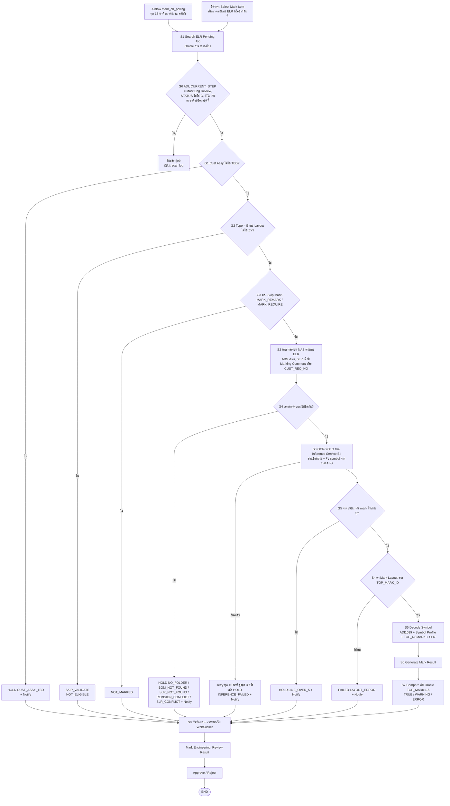

# Mark Automation — Auto Review Flow (B3 + B4) · Design

วันที่: 2026-11-05 · ที่มา: แผนภาพ TO-BE Marking Process ของผู้ใช้ (ภาพ #24) + คำอธิบายของผู้ใช้ 2026-11-05 + engine `mark_engine` (ตัวที่สร้าง run 19)
ต่อจาก: [`2026-11-05-phase2-trial-design.md`](2026-11-05-phase2-trial-design.md) §9, §13 และ [`2026-11-04-phase1-completion-and-phase2-design.md`](2026-11-04-phase1-completion-and-phase2-design.md) §4.5 (B3, B4)

ป้ายในเอกสาร: **[ผู้ใช้]** มาจากผู้ใช้ · **[Claude]** ผู้ออกแบบตัดสินเอง (ผู้ใช้ขอให้ออกแบบเลยโดยไม่ถามต่อ — ตรวจและแก้ได้)

## 1. ทำเพื่ออะไร

ตอนนี้ผลตรวจ mark ขึ้นเว็บได้ก็ต่อเมื่อมีคนรัน pipeline เองเป็นชุด (ดึง Oracle → หาเอกสาร → OCR/YOLO แบบ batch offline → engine → load run)
เป้าหมายคือ **ELR ที่เข้า step Mark Eng Review ถูกตรวจเองและขึ้นหน้าเว็บภายใน 15–20 นาที** ให้วิศวกรเหลือแค่ Review Result → Approve ตามแผนภาพ **[ผู้ใช้]**

**สำเร็จเมื่อ**
- ELR ใหม่ที่ผ่านเงื่อนไขขึ้น Dashboard เองภายใน 20 นาที โดยไม่มีคนสั่ง
- ทุก ELR ที่ถูกกวาดจบที่สถานะที่มองเห็นบนเว็บเสมอ (TRUE / WARNING / ERROR / HOLD / SKIP) — ไม่มี ELR หายเงียบ
- ผลของ ELR เดิมเมื่อรันซ้ำด้วยข้อมูลเดิมต้องเหมือนเดิม (โมเดลและกฎ freeze, บันทึก `model_version` / `engine_version`)

**ไม่ทำ (non-goals)**: เขียนกลับ Oracle / ELR System, ส่ง Email/Teams (แจ้งบนเว็บเท่านั้น), BOTTOM mark, LLM อ่าน SLR (B5), deploy 10.153.90.17 (ผู้ใช้สั่งเอง)

**ห้ามเกิด (anti-goals)**
- ระบบ Approve เอง — Approve เป็นของ Mark Engineering เท่านั้น **[ผู้ใช้: แผนภาพ]**
- ELR ถูกข้ามโดยไม่มีเหตุผลแสดงบนเว็บ
- ผลเปลี่ยนเพราะโมเดล/กฎเปลี่ยนโดยไม่มีบันทึกเวอร์ชัน

## 2. Flow

### 2.1 จุดเริ่ม (แก้ลูกศร A ในแผนภาพ) **[Claude]**
แผนภาพมีลูกศร A จาก "Select Mark Item" ของวิศวกรไปที่ "Search ELR Pending Job" แต่ผู้ใช้อธิบายว่า Airflow กวาดตามช่วงเวลา จึงให้มี **สองทางเข้า pipeline เดียวกัน**:
- **อัตโนมัติ**: DAG `mark_elr_polling` ทุก 15 นาที กวาด ELR ที่ `LAST_TRAN` อยู่ในช่วง `MARK_SCAN_LOOKBACK_DAYS` (ค่าเริ่ม 3 วัน) — ช่วงเวลาตั้งในหน้า Config (B6) ระหว่างนี้ตั้งใน env
- **วิศวกรสั่งเอง**: ปุ่ม "ตรวจใหม่" บนเว็บ ใส่เลข ELR หรือช่วงวันที่ → `POST /api/scans` (role engineer ขึ้นไป) ใช้กับ ELR ที่อยากตรวจทันทีหรือหลังแก้เอกสาร

### 2.2 ลำดับ gate **[Claude]** (เรียงจากถูกไปแพง)
ทุก gate ที่ไม่ผ่านต้องได้สถานะและเหตุผลที่เห็นบนเว็บ

| Gate | เงื่อนไข | ไม่ผ่าน → | มาจาก |
|---|---|---|---|
| G0 | `CUST_CODE='ADI'`, `CURRENT_STEP` = Mark Eng Review (ค่าจริงใน Oracle ให้ผู้สร้างยืนยันจากข้อมูล — spec เดิมเขียน "6"), `STATUS ≠ 'C'`, fingerprint ข้อมูลยังไม่เคยตรวจ | ไม่สร้าง job (บันทึกจำนวนใน scan log) | แผนภาพ "Check ELR Step" — **engine ตอนนี้ไม่ได้กรอง step** |
| G1 | `CUST_ASSY_LOT` ไม่ใช่ `TBD` (ไม่สนตัวพิมพ์และช่องว่าง) | HOLD `CUST_ASSY_TBD` + Notify | แผนภาพ — **ของใหม่** |
| G2 | `TOP_TYPE_CODE = 'E'` และ `TOP_LAYOUT_CODE ≠ 'ZY'` | SKIP_VALIDATE (NOT_ELIGIBLE) | แผนภาพ + engine `pipeline.py:168` |
| G3 | Skip Mark ตาม `MARK_REMARK` / `MARK_REQUIRE` | NOT_MARKED | engine `encode/remark.py` — **ไม่มีในแผนภาพ เสนอเพิ่ม** |
| G4 | เอกสารบน NAS ครบและไม่ขัดกัน | HOLD ตามเหตุ + Notify | engine `documents/resolve.py` — **ไม่มีในแผนภาพ เสนอเพิ่ม** |
| G5 | จำนวนบรรทัด mark ที่ต้องพิมพ์ ≤ 5 (Oracle เก็บได้แค่ TOP_MARK1–5) | HOLD `LINE_OVER_5` + Notify | แผนภาพ — **ของใหม่** |
| S4 | มี layout ของ `TOP_MARK_ID` | FAILED `LAYOUT_ERROR` + Notify | engine |

- **G2 อยู่ก่อนหาเอกสาร** ต่างจากแผนภาพที่วางไว้หลัง "Verify Top Mark" ผลลัพธ์เหมือนกัน (Skip Validate) แต่ไม่เสียเวลาค้น NAS/OCR กับงานที่ไม่ต้องตรวจ — ผลต่างเดียวคือ ELR ที่เป็น ZY และเอกสารหายจะได้ SKIP แทน HOLD
- **G5 นับจาก**: จำนวนบรรทัดที่ได้จาก requirement (SLR marking spec ถ้ามี ไม่งั้นบรรทัด TOP mark บน ABS ที่ OCR อ่านได้) — ผู้สร้างใช้ตัวนับบรรทัดเดียวกับที่ engine ใช้สร้าง expected lines

### 2.3 เลือก SLR หรือ ABS มาตรฐาน **[Claude]**
แผนภาพใช้ "Check Marking Comment?" ส่วน engine ใช้ `CUST_REQ_NO` → ใช้ **ทั้งสองอย่าง**: ต้องมี SLR เมื่อมี marking comment (ฟิลด์ remark ใน Oracle ที่อ้างถึง special requirement) **หรือ** มี `CUST_REQ_NO` ที่ไม่ใช่ N/A — ไม่มีทั้งคู่ใช้ ABS มาตรฐาน
เหตุผล: ไม่ทำให้ผล run 19 ที่ผ่านแล้วเปลี่ยน และจับกรณีที่แผนภาพตั้งใจเพิ่ม · ผู้สร้างต้องวัดว่ากฎนี้ทำให้ผล run 19 เปลี่ยนกี่ ELR ก่อน merge (ดู §7)

## 3. ส่วนประกอบ (ใครทำอะไร) **[Claude]**

| ส่วน | อยู่ที่ | หน้าที่ |
|---|---|---|
| Airflow DAG | 10.151.28.3 | `mark_elr_polling` (15 นาที) เรียก `POST /api/scans` · `mark_pending_job_retry` (10 นาที) เรียก `POST /api/scans/retry` · **เรียก API เท่านั้น ไม่ต่อ Oracle/NAS/DB เอง** (spec เดิม §4.4) |
| Mark API | `services/api` (มีอยู่) | รับคำสั่ง scan, ตรวจสิทธิ์ (API token scope `scan:write` สำหรับ Airflow / session สำหรับวิศวกร), ใส่งานลงคิว, WebSocket `/api/ws` |
| Mark Worker | container ใหม่ `services/worker` บนเครื่องเดียวกับ API | ดึงงานจากคิว แล้วรัน gate G0–S8 ด้วย `mark_engine` เดิม · ต่อ Oracle (read-only), NAS (read-only), Inference Service |
| Inference Service (B4) | AI Server 10.151.28.9 | gRPC ตาม phase2 spec §13: `Page`, `Rec`, `Symbols` + health · ทุกผลมี `model_version` · ใช้โมเดล freeze เดิม (`models/ocr-rec-exp09`, `trocr-exp08a`, `symdet`) |
| PostgreSQL | 10.151.28.2 | คิวงานและผล (ข้อ 4) |

- คิวใช้ตาราง PostgreSQL + `SELECT … FOR UPDATE SKIP LOCKED` ไม่เพิ่ม Redis (spec เดิมไม่ใช้ Redis)
- แจ้งหน้าเว็บ: worker `NOTIFY mark_events` → API ส่ง WebSocket `job.updated` → หน้าเว็บดึงรายละเอียดผ่าน REST และล้าง cache dashboard ของ run นั้น (phase2 spec §13, §18)
- Worker 1 ตัวในช่วงแรก (ELR ต่อวันหลักสิบ) — ขยายเป็นหลายตัวได้เพราะใช้ SKIP LOCKED

## 4. ข้อมูล **[Claude]**

**ผลลัพธ์**: เขียนเป็น run ใหม่ใน `mark_logic` แบบเดียวกับ run 19 — **หนึ่ง run ต่อวัน** (`period = auto-YYYY-MM-DD`) หน้าเว็บที่มีอยู่ใช้ได้ทันทีโดยไม่ต้องแก้ query
- ห้ามเขียนทับ run 1–19 · run อัตโนมัติเป็น run_id ใหม่เสมอ
- ELR เดียวกันถูกตรวจซ้ำได้ (เอกสารเปลี่ยน, วิศวกรสั่งใหม่) → หน้าเว็บต้องมีมุมมอง "ผลล่าสุดของแต่ละ ELR" ข้าม run (view `mark_app.latest_job_result`) — Approve ผูกกับ run_id ที่วิศวกรดูอยู่ตามเดิม

**ตารางใหม่ใน `mark_app`**

| ตาราง | คอลัมน์หลัก | ใช้ทำ |
|---|---|---|
| `scan` | scan_id, source (`airflow`/`user`), requested_by, from_ts, to_ts, elr_list, found, queued, skipped, started_at, finished_at | ประวัติการกวาดแต่ละรอบ (ตอบว่า "รอบนี้เจอกี่ ELR ข้ามกี่ตัวเพราะอะไร") |
| `work_item` | item_id, scan_id, elr_no, fingerprint, state (`queued`/`running`/`done`/`retry`/`failed`), attempts, next_attempt_at, run_id, error, created_at, updated_at · unique (elr_no, fingerprint) | คิวงานและกันงานซ้ำ |
| `notification` | notification_id, elr_no, run_id, kind (`HOLD`/`FAILED`/`LINE_OVER_5`/…), message, created_at, read_by, read_at | Notify User บนเว็บ (badge) — B6 ต่อยอดหน้าจัดการ |

**fingerprint** = sha256 ของ (snapshot Oracle ของ ELR ที่ engine ใช้ + sha256 ของเอกสารที่ resolve ได้ + `engine_version` + `model_version`) — เหมือนเดิมแปลว่าไม่ต้องตรวจซ้ำ

## 5. Inference Service (B4) **[Claude]** (ต่อจาก phase2 spec §13)
- proto `proto/mark/inference/v1/inference.proto` ตามที่ออกแบบไว้แล้ว · ภาพส่งเป็น bytes
- ความปลอดภัย: API key ใน metadata `x-api-key` + firewall เปิดเฉพาะ IP เครื่อง API (ระหว่างทดลองคือเครื่องผู้ใช้)
- **เกณฑ์ผ่าน B4**: รันกับ ABS ทั้งหมดของ run 19 ผ่าน service แล้วผล OCR/YOLO ต้องตรงกับ cache batch เดิม (`mark_engine/adapters/inference_cache.py`) ทุกบรรทัด — ถ้าไม่ตรงต้องอธิบายได้ (เช่น ลำดับ batch) ก่อนเปิดใช้
- Worker ยังอ่าน cache batch ได้ (ตั้ง `MARK_INFERENCE=cache|service`) เพื่อทดสอบเทียบและสำรองตอน AI Server ล่ม

## 6. Notify User **[ผู้ใช้: แจ้งบนเว็บเท่านั้น]**
- เกิดเมื่อ: HOLD ทุกเหตุ, LINE_OVER_5, CUST_ASSY_TBD, FAILED, INFERENCE_FAILED หลัง retry ครบ, scan ล้มทั้งรอบ (Oracle/NAS ต่อไม่ได้)
- แสดง: badge ที่ header + รายการในหน้า Dashboard (กดแล้วไป ELR นั้น) · หนึ่ง ELR หนึ่งเหตุ แจ้งครั้งเดียวจนกว่าผลจะเปลี่ยน
- scan ล้มทั้งรอบ: log `scan.failed` + notification ถึง admin

## 7. ข้อจำกัดและเกณฑ์รับงาน
- Oracle อ่านอย่างเดียว (`SET TRANSACTION READ ONLY`) · NAS อ่านอย่างเดียว · ห้ามแตะ R0 `D:\CIM Project\mark` และ run 1–17 (และ 18–19 ที่ใช้ทดลอง)
- Gate ใหม่ (G0 step, G1 TBD, G5 LINE_OVER_5, กฎ SLR §2.3) **ต้องรัน regression กับ run 19 ก่อน merge** และรายงานว่าผลเปลี่ยนกี่ ELR ไปทางไหน — ผลที่เปลี่ยนต้องให้ผู้ใช้ยืนยัน
- ทุก task: unit test + Jenkins เขียว · real-DB check (`scripts/check_trial_readonly.py`) และ E2E (`scripts/e2e_walkthrough.py`) ยังผ่าน
- end-to-end: ELR ทดสอบจริง 1 ตัวที่เข้า step ใหม่ ขึ้นเว็บเองภายใน 20 นาทีหลัง DAG รอบถัดไป

## 8. ลำดับสร้าง **[Claude]**
1. **Engine gates**: G0 step filter, G1 TBD, G5 LINE_OVER_5, กฎ SLR §2.3 + regression run 19 (ไม่ต้องรอเครื่องอื่น)
2. **B4 Inference Service** บน AI Server + เทียบผลกับ cache batch
3. **คิว + Worker + `POST /api/scans`** (ใช้ cache ก่อน แล้วสลับเป็น service)
4. **Airflow DAG** `mark_elr_polling`, `mark_pending_job_retry`
5. **Notify + WebSocket + view ผลล่าสุดต่อ ELR** บนหน้าเว็บ

## 9. ให้ผู้สร้างตัดสินเอง
ชื่อฟิลด์ marking comment ใน Oracle (ดูจาก snapshot จริง), ค่า `CURRENT_STEP` ของ Mark Eng Review, รูปแบบข้อความ notification, การจัดไฟล์ใน `services/worker`, ขนาด batch ที่ส่งให้ Inference Service

## 10. ต้องให้ผู้ใช้ยืนยัน (ผู้ออกแบบเดาไว้)
1. ทางเข้าสองทาง (Airflow ทุก 15 นาที + ปุ่มตรวจใหม่) แทนลูกศร A
2. G2 (Type/Layout) อยู่ก่อนหาเอกสาร
3. กฎเลือก SLR = marking comment **หรือ** CUST_REQ_NO
4. G5 นับบรรทัดจาก requirement ของเอกสาร
5. เก็บผลเป็น run รายวันใน `mark_logic` + มุมมองผลล่าสุดต่อ ELR
