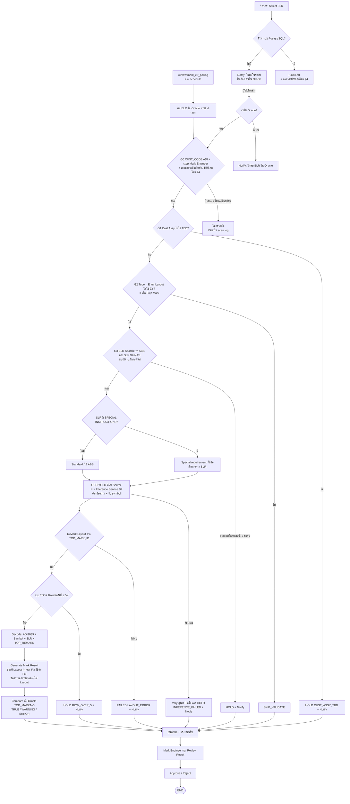

# Mark Automation — Auto Review Flow (B3 + B4) · Design

วันที่: 2026-11-05 (แก้ครั้งที่ 3 — ผู้ใช้ยืนยัน §10 แล้ว) · ที่มา: แผนภาพ TO-BE Marking Process ของผู้ใช้ (ภาพ #24) + คำอธิบายและการแก้ของผู้ใช้ 2026-11-05 + engine `mark_engine` (ตัวที่สร้าง run 19)
ต่อจาก: [`2026-11-05-phase2-trial-design.md`](2026-11-05-phase2-trial-design.md) §9, §13 และ [`2026-11-04-phase1-completion-and-phase2-design.md`](2026-11-04-phase1-completion-and-phase2-design.md) §4.5 (B3, B4)

ป้ายในเอกสาร: **[ผู้ใช้]** มาจากผู้ใช้ · **[Claude]** ผู้ออกแบบตัดสินเอง (ตรวจและแก้ได้)

## 1. ทำเพื่ออะไร

ตอนนี้ผลตรวจ mark ขึ้นเว็บได้ก็ต่อเมื่อมีคนรัน pipeline เองเป็นชุด (ดึง Oracle → หาเอกสาร → OCR/YOLO batch offline → engine → load run)
เป้าหมาย: **ELR ที่อยู่ step Mark Engineer ถูกตรวจเองตาม schedule และวิศวกรสั่งตรวจราย ELR ได้** เหลือแค่ Review Result → Approve ตามแผนภาพ **[ผู้ใช้]**

**สำเร็จเมื่อ**
- ELR ใหม่ที่ผ่านเงื่อนไขขึ้น Dashboard เองภายใน 20 นาทีหลังรอบ schedule
- วิศวกรพิมพ์เลข ELR ที่ยังไม่มีในระบบ แล้วสั่งดึงจาก Oracle มาตรวจได้ทันที
- ทุก ELR ที่เข้า flow จบที่สถานะที่มองเห็นบนเว็บเสมอ (TRUE / WARNING / ERROR / HOLD / SKIP) — ไม่มี ELR หายเงียบ
- ELR ที่เคยตรวจแล้วถูกตรวจใหม่เฉพาะเมื่อข้อมูลเปลี่ยนจริง และบอกได้ว่าอะไรเปลี่ยน (§4)

**ไม่ทำ (non-goals)**: เขียนกลับ Oracle / ELR System, ส่ง Email/Teams (แจ้งบนเว็บเท่านั้น), BOTTOM mark, LLM อ่าน SLR (B5), deploy 10.153.90.17 (ผู้ใช้สั่งเอง)

**ห้ามเกิด (anti-goals)**
- ระบบ Approve เอง — Approve เป็นของ Mark Engineering เท่านั้น **[ผู้ใช้: แผนภาพ]**
- ELR ถูกข้ามโดยไม่มีเหตุผลแสดงบนเว็บ
- ผลที่ Approve แล้วถูกแทนที่เงียบ ๆ เมื่อข้อมูลเปลี่ยน
- ผลเปลี่ยนเพราะโมเดล/กฎเปลี่ยนโดยไม่มีบันทึกเวอร์ชัน

## 2. Flow **[ผู้ใช้]** (ลำดับตามที่ผู้ใช้กำหนด 2026-11-05)

### 2.1 ทางเข้า 2 ทาง **[ผู้ใช้]**
- **Schedule** **[ผู้ใช้]**: Airflow DAG `mark_elr_polling` ทุก **15 นาที** กวาดเฉพาะช่วงตั้งแต่รอบที่แล้ว (ย้อนหลังตามรอบ 15 นาที ไม่ใช่หลายวัน)
  - ช่วงที่กวาด **[Claude]**: `LAST_TRAN` ตั้งแต่ `to_ts` ของ scan ล่าสุดที่สำเร็จ (watermark) **ลบ 5 นาที** (กันขอบเวลาและนาฬิกาไม่ตรง) ถึงเวลาปัจจุบัน — รอบไหนล้ม รอบถัดไปจะกวาดต่อจาก watermark เดิมเอง ไม่มีช่องว่าง · ELR ที่ซ้ำเพราะช่วงทับกันถูกกรองด้วย fingerprint (§4)
  - **Initial load ก่อนเปิดรอบ** **[ผู้ใช้]**: รันครั้งเดียวก่อนเปิด schedule — กวาด ELR ที่ยังอยู่ step Mark Engineer ทั้งหมด (หรือช่วงวันที่ที่ผู้ใช้กำหนด) ผ่าน `POST /api/scans` ด้วย `source=initial` แล้วตั้ง watermark = เวลาที่ initial เริ่ม
  - เอกสารบน NAS เปลี่ยนโดยที่ `LAST_TRAN` ไม่เปลี่ยน → DAG `mark_pending_job_retry` (10 นาที) เช็ก NAS ซ้ำให้ ELR ที่ยัง HOLD/ยังไม่ Approve และยังอยู่ step Mark Engineer **[Claude]**
- **Select by user** (ตรวจราย ELR):
  1. ค้นในระบบเรา (PostgreSQL) ก่อน — **มี** → เปิดผลเดิม และตรวจว่ามีอัปเดตตาม §4 (มี → บอกบนหน้าและให้กด "ตรวจใหม่")
  2. **ไม่มี** → Notify "ไม่พบ ELR นี้ในระบบ" พร้อมให้เลือก "ค้นใน Oracle"
  3. ผู้ใช้เลือกค้น → **พบใน Oracle** → ดึงข้อมูล ELR มาเข้า flow เดียวกับ Airflow แต่ trigger เฉพาะ ELR นั้น (เริ่มที่ G0) · **ไม่พบ** → Notify "ไม่พบ ELR ใน Oracle"
  - ถ้าพบใน Oracle แต่ไม่ผ่าน G0 (ไม่ใช่ ADI หรือไม่อยู่ step Mark Engineer) → Notify บอกเหตุผล ไม่สร้างผล **[Claude]**

### 2.2 Gate **[ผู้ใช้]** (รายละเอียดการเช็ก **[Claude]**)

| Gate | เช็ก | ไม่ผ่าน → | หมายเหตุ |
|---|---|---|---|
| G0 | `CUST_CODE='ADI'`, `CURRENT_STEP = '6'` (Mark Eng review — **ผู้ใช้ยืนยัน 2026-11-05**), เคยตรวจหรือยัง / มีอัปเดตไหม (§4) | ไม่ตรวจ (บันทึกเหตุผลใน scan log) | ตั้งใน env `MARK_REVIEW_STEP=6` · ตารางรหัส step ดู §2.4 |
| G1 | `CUST_ASSY_LOT` ไม่ใช่ `TBD` (ไม่สนตัวพิมพ์/ช่องว่าง) | HOLD `CUST_ASSY_TBD` + Notify | **ใหม่** · ผู้ใช้พิมพ์ "THB" ในข้อความล่าสุด ผู้ออกแบบถือว่าเป็น TBD ตามแผนภาพ (ยืนยันใน §10) |
| G2 | `TOP_TYPE_CODE='E'` และ `TOP_LAYOUT_CODE≠'ZY'` — **คือการเช็ก Skip Mark** | SKIP_VALIDATE | มีใน engine (`pipeline.py:168`) · run 19 ไม่มี ELR ที่ skip ด้วยเหตุอื่นนอกจาก ZY (NOT_MARKED = 0) — ตัวเช็ก `MARK_REMARK`/`MARK_REQUIRE` เดิมคงไว้เป็นกันพลาดภายใน ผลรวมเป็น SKIP_VALIDATE เหมือนกัน **[Claude]** |
| G3 | ELR Search: หา **ABS และ SLR** บน NAS (`\\th1srnas03\ADI`) ตามเลข ELR — **ต้องมีครบทั้งสอง** เพราะถ้าไม่มี SLR จะไม่รู้ว่าเป็น Special requirement ไหม **[ผู้ใช้]** | HOLD ตามเหตุ (`NO_FOLDER`, `ABS_NOT_FOUND`/`BOM_NOT_FOUND`, `SLR_NOT_FOUND`, `REVISION_CONFLICT`, `SLR_CONFLICT`) + Notify | engine `documents/resolve.py` มีเหตุเหล่านี้แล้ว |
| Special? | SLR มีหัวข้อ `SPECIAL INSTRUCTIONS` → Special requirement (ใช้ข้อกำหนดจาก SLR) · ไม่มี → Standard (ใช้ ABS) **[ผู้ใช้]** | — | รวมกับ G3 เป็นขั้นเดียว **[ผู้ใช้]** · engine มีตัวจับหัวข้อนี้แล้ว (`slr/parse.py:97`, `documents/classify.py:25`) — แทนกฎเดิมที่ใช้ `CUST_REQ_NO` |
| — | OCR/YOLO ที่ AI Server | retry แล้ว HOLD `INFERENCE_FAILED` + Notify | §5 |
| — | Mark Layout ของ `TOP_MARK_ID` | FAILED `LAYOUT_ERROR` + Notify | engine |
| G5 | จำนวน Row ผลลัพธ์ ≤ 5 (Oracle เก็บได้แค่ TOP_MARK1–5) | HOLD `ROW_OVER_5` + Notify | **ใหม่** · นับหลังได้ผล OCR และ layout แล้ว ตามลำดับของผู้ใช้ |

### 2.4 รหัส `CURRENT_STEP` ใน Oracle **[ผู้ใช้ 2026-11-05]**

| รหัส | ขั้น |
|---|---|
| `1` | CS Review |
| `A` | QA Review |
| `2` | Engineering Review |
| `3` | MC review |
| `4` | Engineering lot Center |
| `5` | PC Reserve |
| **`6`** | **Mark Eng review** ← ขั้นที่ระบบกวาดมาตรวจ |
| `7` | Generate Order |

ข้อมูลจริง 2026-11-05 (ADI, STATUS ≠ C): 1=246, 2=2, 4=4, 5=2, 6=0, 7=8,290 — ELR อยู่ step 6 ไม่นาน จึงต้องกวาดทุก 15 นาทีเพื่อจับให้ทันก่อนเลื่อนไป step 7 · ช่วงที่ไม่มี ELR ที่ step 6 เป็นเรื่องปกติ ไม่ใช่ error · รหัสเป็นข้อความ (มี `A`) จึงเทียบแบบ string

### 2.3 Decode และ Generate **[ผู้ใช้]**
- Decode ด้วย ADI1039 + Symbol Profile + SLR + TOP_REMARK — มีใน engine (`encode/adi1039.py`, `encode/symbol_adi.py`, `encode/remark.py`)
- Generate: ตำแหน่งใน Layout บอกช่องที่ลงข้อความ · ช่องที่ Layout กำหนด Fix ให้ใช้ค่า Fix ในตำแหน่งนั้น — **engine ทำแล้ว** (`generate/mark_layout.py:43` `fill_line_with_conflicts`: ช่อง Fix ใช้ค่าใน layout, ข้อความลงช่องว่างตามลำดับ) ไม่ต้องสร้างใหม่ แค่ต้องมี test ที่ยืนยันกรณี Fix ใน flow ใหม่

## 3. ส่วนประกอบ **[Claude]**

| ส่วน | อยู่ที่ | หน้าที่ |
|---|---|---|
| Airflow DAG | 10.151.28.3 | `mark_elr_polling` (schedule) เรียก `POST /api/scans` · `mark_pending_job_retry` (10 นาที) เรียก `POST /api/scans/retry` · **เรียก API เท่านั้น ไม่ต่อ Oracle/NAS/DB เอง** (spec เดิม §4.4) |
| Mark API | `services/api` (มีอยู่) | `POST /api/scans` (Airflow ใช้ API token scope `scan:write`) · `GET /api/elrs/lookup?elr=` (ค้นในระบบ) · `POST /api/elrs/{elr}/oracle-check` (ค้น Oracle แล้ว trigger) · คิวงาน · WebSocket `/api/ws` |
| Mark Worker | container ใหม่ `services/worker` | ดึงงานจากคิว รัน G0–Compare ด้วย `mark_engine` เดิม · ต่อ Oracle (read-only), NAS (read-only), Inference Service |
| Inference Service (B4) | AI Server 10.151.28.9 | รัน OCR/YOLO บน server · worker ส่งภาพไปและรับผลกลับผ่าน endpoint ของ service **[ผู้ใช้]** · ใช้ gRPC ตาม phase2 spec §13 (`Page`, `Rec`, `Symbols`, health) |
| PostgreSQL | 10.151.28.2 | คิว ประวัติ และผล (§4) |

- คิวใช้ตาราง PostgreSQL + `SELECT … FOR UPDATE SKIP LOCKED` ไม่เพิ่ม Redis
- แจ้งหน้าเว็บ: worker `NOTIFY mark_events` → API ส่ง WebSocket `job.updated` → หน้าเว็บดึงรายละเอียดผ่าน REST และล้าง cache dashboard
- Worker 1 ตัวช่วงแรก ขยายได้เพราะใช้ SKIP LOCKED

## 4. ประวัติและการตรวจอัปเดต **[ผู้ใช้: "เช็คว่าเคยเก็บประวัติยัง ถ้าเคยแล้วต้องเช็คว่าอาจจะอัปเดต — ช่วยคิด Logic"]** · logic **[Claude]**

**อะไรนับว่า "อัปเดต"** — เก็บ fingerprint ของ input แยกเป็น 3 ส่วน ทุกครั้งที่ตรวจ:

| ส่วน | มาจาก | ตัวอย่างการเปลี่ยน |
|---|---|---|
| `oracle_fp` | sha256 ของฟิลด์ Oracle ที่ engine ใช้: `PRODUCT_NO`, `CUST_ASSY_LOT`, `TOP_MARK1–5`, `TOP_MARK_ID`, `TOP_TYPE_CODE`, `TOP_LAYOUT_CODE`, `MARK_REMARK`, `MARK_REQUIRE`, `CUST_REQ_NO`, `CURRENT_STEP`, `STATUS` | วิศวกรแก้ TOP_MARK ใน ELR System, Cust Assy เปลี่ยนจาก TBD เป็นค่าจริง |
| `docs_fp` | sha256 ของไฟล์ ABS และ SLR ที่ resolve ได้ (รวม revision) | ลูกค้าส่ง ABS revision ใหม่, SLR ถูกเพิ่มเข้า NAS |
| `version_fp` | `engine_version` + `model_version` | อัปเกรด engine / โมเดล |

**ตัดสินใจ**

| สถานการณ์ | ทำอะไร |
|---|---|
| ไม่เคยตรวจ | ตรวจ |
| เคยตรวจ, `oracle_fp` และ `docs_fp` เหมือนเดิม | **ไม่ตรวจซ้ำ** (นับเป็น `unchanged` ใน scan log) |
| `oracle_fp` หรือ `docs_fp` เปลี่ยน | ตรวจใหม่ → ได้ revision ใหม่ของ ELR และบันทึกว่าส่วนไหนเปลี่ยน (`changed: oracle` / `docs` / ทั้งคู่) |
| เปลี่ยน และผลเดิม **Approve แล้ว** **[ผู้ใช้]** | revision เดิมพร้อม Approve เก็บเป็น **History** (ไม่แก้ ไม่ลบ) · ผลใหม่เป็น **revision ใหม่** ที่มีวันที่สร้างของตัวเอง เริ่มสถานะยังไม่ Approve + Notify |
| **กันซ้ำกับของเก่า** **[ผู้ใช้: ขอ logic]** | ก่อนสร้าง revision ใหม่ เทียบคู่ (`oracle_fp`, `docs_fp`) กับ **ทุก revision เก่า** ของ ELR นั้น ไม่ใช่แค่ตัวล่าสุด — ถ้าตรงกับตัวใดตัวหนึ่ง (เช่น ข้อมูลถูกแก้กลับเป็นค่าเดิม) **ไม่สร้าง revision ใหม่** แต่บันทึกใน scan log ว่า `same_as_rev=N` · นอกจากนี้เก็บ `result_fp` (sha256 ของ expected mark + สถานะทุกบรรทัด) ถ้า input ต่างแต่ผลตรงกับ revision ล่าสุด → สร้าง revision ได้ (เป็นประวัติว่า input เปลี่ยน) แต่ติดป้าย `result_unchanged` และไม่ Notify **[Claude]** |
| เคย HOLD (เช่น ไม่มี SLR, Cust Assy TBD) | ตรวจใหม่อัตโนมัติเมื่อ `oracle_fp`/`docs_fp` เปลี่ยน — คือทางที่ HOLD หลุดเองเมื่อมีคนแก้ข้อมูล |
| `version_fp` เปลี่ยนอย่างเดียว | **ไม่ตรวจซ้ำอัตโนมัติ** (กันงานท่วมทุกครั้งที่อัปเกรด) — วิศวกรกด "ตรวจใหม่" เอง หรือสั่ง re-run เป็นชุดแยก |
| ELR ออกจาก step Mark Engineer แล้ว | หยุดติดตาม (G0 ไม่ผ่าน) ผลเดิมยังดูได้ |
| วิศวกรกด "ตรวจใหม่" | ตรวจเสมอ แม้ fingerprint เหมือนเดิม |

**ประหยัดงาน**: เช็ก Oracle ก่อน (ถูก) · NAS ใช้ path + ขนาด + เวลาแก้ไขไฟล์ เป็นตัวกรองก่อน แล้วค่อยคำนวณ sha256 เมื่อสามอย่างนี้เปลี่ยน

## 5. ข้อมูล **[Claude]**

**ผลลัพธ์** **[ผู้ใช้: ใช้แสดง Dashboard]**: เขียนเป็น run ใหม่ใน `mark_logic` แบบเดียวกับ run 19 — **หนึ่ง run ต่อวัน** (`period = auto-YYYY-MM-DD`) หน้าเว็บเดิมใช้ได้ทันที
- ห้ามเขียนทับ run 1–19 · run อัตโนมัติเป็น run_id ใหม่เสมอ
- ELR หนึ่งตัวอาจมีหลาย revision ข้าม run → view `mark_app.latest_job_result` ให้หน้าเว็บแสดง "ผลล่าสุดต่อ ELR" · Approve ผูกกับ run_id ที่วิศวกรดูอยู่ตามเดิม

**ตารางใหม่ใน `mark_app`**

| ตาราง | คอลัมน์หลัก | ใช้ทำ |
|---|---|---|
| `scan` | scan_id, source (`airflow`/`initial`/`user`), requested_by, from_ts, to_ts, elr_no (ราย ELR), found, queued, unchanged, skipped, started_at, finished_at, error | ประวัติการกวาดแต่ละรอบ |
| `elr_revision` | elr_no, revision, oracle_fp, docs_fp, version_fp, result_fp, changed (`new`/`oracle`/`docs`/`both`/`manual`), result_unchanged, run_id, created_at · unique (elr_no, revision) · unique (elr_no, oracle_fp, docs_fp) | ประวัติ (History) และการตรวจอัปเดต (§4) — revision ที่ Approve แล้วไม่ถูกแก้ |
| `work_item` | item_id, scan_id, elr_no, state (`queued`/`running`/`done`/`retry`/`failed`), attempts, next_attempt_at, revision, error, created_at, updated_at | คิวงาน |
| `notification` | notification_id, elr_no, run_id, kind, message, created_at, read_by, read_at | Notify บนเว็บ |

## 6. Inference Service (B4) **[Claude]** (ต่อจาก phase2 spec §13)
- รันบน AI Server, worker ส่งภาพ ABS ไปและรับข้อความ/symbol กลับ **[ผู้ใช้]** · ภาพส่งเป็น bytes · ทุกผลมี `model_version`
- โมเดล freeze เดิม: `models/ocr-rec-exp09`, `models/trocr-exp08a`, `models/symdet`
- ความปลอดภัย: API key ใน metadata `x-api-key` + firewall เปิดเฉพาะ IP เครื่อง API
- **เกณฑ์ผ่าน**: ABS ทั้งหมดของ run 19 ผ่าน service แล้วผลตรงกับ cache batch เดิม (`mark_engine/adapters/inference_cache.py`) ทุกบรรทัด — ไม่ตรงต้องอธิบายได้ก่อนเปิดใช้
- Worker เลือก `MARK_INFERENCE=cache|service` เพื่อเทียบและสำรองตอน AI Server ล่ม

## 7. Notify **[ผู้ใช้: แจ้งบนเว็บ]**
- เกิดเมื่อ: ไม่พบ ELR ในระบบ, ไม่พบใน Oracle, ไม่ผ่าน G0 ตอนผู้ใช้สั่ง, HOLD ทุกเหตุ, ROW_OVER_5, CUST_ASSY_TBD, FAILED, INFERENCE_FAILED หลัง retry ครบ, ข้อมูลเปลี่ยนหลัง Approve, scan ล้มทั้งรอบ
- แจ้งที่ผู้ใช้สั่ง (ไม่พบในระบบ/Oracle) แสดงทันทีบนหน้าที่กดอยู่ · ที่เหลือเป็น badge ที่ header + รายการบน Dashboard
- หนึ่ง ELR หนึ่งเหตุ แจ้งครั้งเดียวจนกว่าผลจะเปลี่ยน · scan ล้มทั้งรอบแจ้ง admin

## 8. ข้อจำกัดและเกณฑ์รับงาน
- Oracle อ่านอย่างเดียว (`SET TRANSACTION READ ONLY`) · NAS อ่านอย่างเดียว · ห้ามแตะ R0 `D:\CIM Project\mark` และ run 1–19
- Gate ใหม่/กฎใหม่ (G0 step, G1 TBD, G3 ต้องมี SLR เสมอ + Special จาก SPECIAL INSTRUCTIONS, G5 ROW_OVER_5) **ต้องรัน regression กับ run 19 ก่อน merge** แล้วรายงานว่าผลเปลี่ยนกี่ ELR ไปทางไหน — ผลที่เปลี่ยนต้องให้ผู้ใช้ยืนยัน
- ทุก task: unit test + Jenkins เขียว · real-DB check และ E2E เดิมยังผ่าน
- end-to-end: (1) ELR จริง 1 ตัวที่เข้า step ใหม่ ขึ้นเว็บเองหลังรอบ schedule ถัดไป (2) วิศวกรพิมพ์ ELR ที่ไม่มีในระบบ → Notify → ค้น Oracle → ได้ผลบนเว็บ (3) แก้ข้อมูล 1 ฟิลด์ใน fingerprint (จำลอง) → รอบถัดไปตรวจใหม่และบอกว่าอะไรเปลี่ยน

## 9. ลำดับสร้าง **[Claude]**
1. **Engine gates + regression run 19**: G0 step, G1 TBD, G3 ต้องมี ABS+SLR และ Special จาก SPECIAL INSTRUCTIONS, G5 ROW_OVER_5, test กรณี Fix ใน layout
2. **B4 Inference Service** บน AI Server + เทียบกับ cache batch
3. **ประวัติ/fingerprint + คิว + Worker + API** (`/api/scans`, lookup, oracle-check)
4. **Airflow DAG** `mark_elr_polling`, `mark_pending_job_retry`
5. **Notify + WebSocket + ผลล่าสุดต่อ ELR + ปุ่ม Select ELR / ตรวจใหม่** บนหน้าเว็บ

## 10. ผู้ใช้ยืนยันแล้ว (2026-11-05)
1. G1 เช็ก **TBD**
2. Approve แล้วเก็บเป็น History · ข้อมูลใหม่เป็น revision ใหม่คนละวันที่สร้าง · ต้องมี logic กันซ้ำกับของเก่า (§4)
3. ต้องมี ABS และ SLR ครบทุก ELR
4. Schedule ทุก 15 นาที กวาดย้อนหลังตามรอบ · ทำ Initial load ก่อนเปิดรอบ (§2.1)
5. เก็บผลเป็น run รายวันเพื่อแสดง Dashboard

## 11. ให้ผู้สร้างตัดสินเอง
ค่า `CURRENT_STEP` ของ Mark Engineer (ดูจาก Oracle จริง), รูปแบบข้อความ notification, การจัดไฟล์ใน `services/worker`, ขนาด batch ที่ส่งให้ Inference Service, ชื่อ endpoint ย่อยของ API
