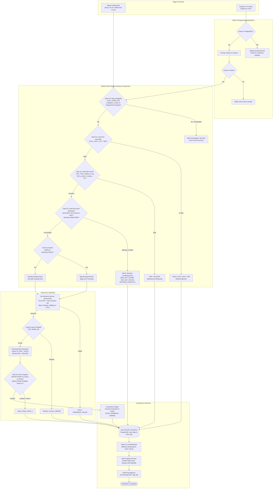
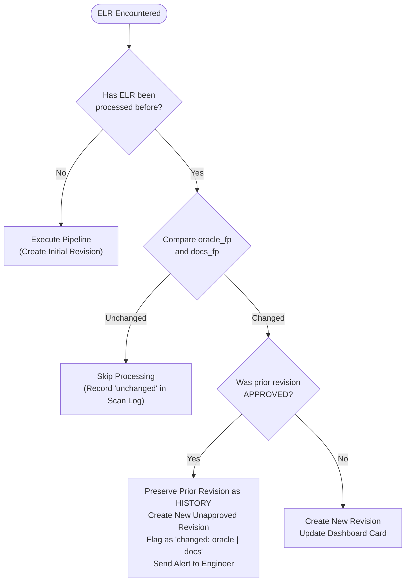
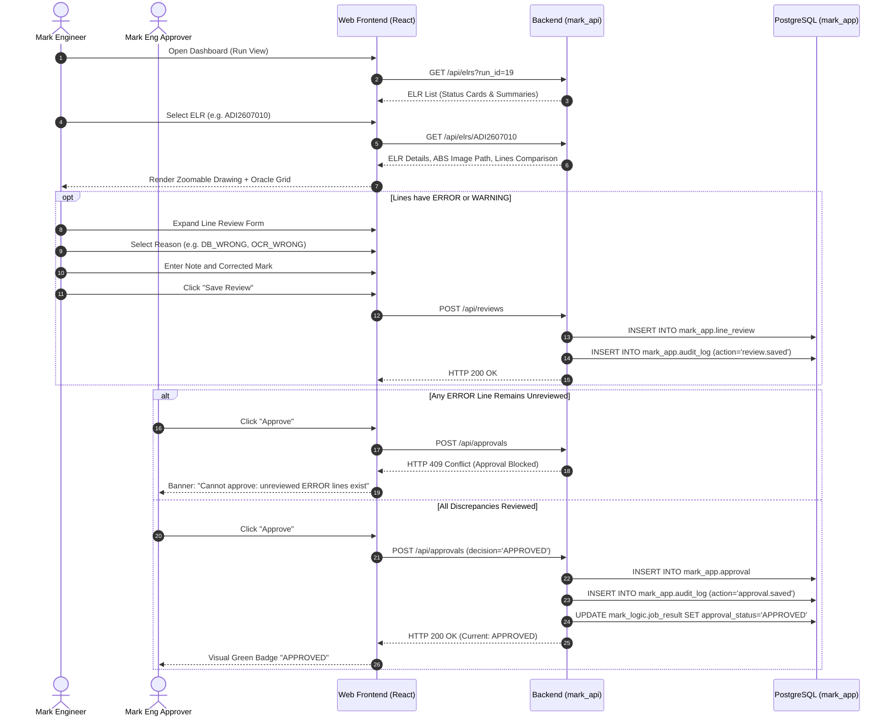

# End-to-End Workflow Specification (`workflow.md`)

> **Workflow:** Mark Automation — Auto Review & Approval Lifecycle (B3 + B4)  
> **Source:** TO-BE Marking Process Specification & User Confirmations (2026-11-05)  
> **Target Engine:** `mark_engine` v0.4.0

---

## 1. End-to-End Process Flow

The Mark Automation platform continuously monitors new and updated Engineering Lot Requests (ELRs) in Oracle ERP, processes customer engineering drawings via AI inference, applies domain validation gates, and presents discrepancies to Mark Engineers for review and approval.



---

## 2. The Ordered Gate Pipeline (G0 → G5)

To optimize execution speed and server resource usage, validation checks are strictly sequenced from **computationally cheap database checks** to **expensive network and AI GPU tasks**:

```
[G0: Oracle Filter] ➔ [G1: TBD Check] ➔ [G2: Skip Mark] ➔ [G3: NAS Docs] ➔ [B4: AI Inference] ➔ [G5: Row Limit] ➔ [Compare]
```

### Gate G0: Step & Customer Selector
- **Condition**:
  1. `CUST_CODE == 'ADI'`
  2. `STATUS != 'C'` (Closed)
  3. `CURRENT_STEP == '6'` (`Mark Eng review`)
  4. Fingerprint update check (evaluates whether data changed since last run)
- **Outcome if Failed**:
  - The ELR is skipped and logged in the scan summary. No job or run row is created.
- **Oracle Step Reference**:
  - `1`: CS Review | `A`: QA Review | `2`: Engineering Review | `3`: MC Review
  - `4`: Engineering Lot Center | `5`: PC Reserve | **`6`: Mark Eng Review (Target)** | `7`: Generate Order

### Gate G1: Customer Assembly Lot TBD
- **Condition**: `CUST_ASSY_LOT` is case-insensitively checked for `"TBD"` (e.g. `"TBD"`, `"tbd"`, `" Tbd "`).
- **Outcome if Failed**:
  - Halts immediately with `HOLD:CUST_ASSY_TBD`.
  - Resolution is not attempted. Line comparisons are marked `LineStatus.NOT_MEASURABLE` with detail `"CUST_ASSY_TBD"`.
  - Notification sent to UI.

### Gate G2: Skip Mark Eligibility
- **Condition**: Evaluates whether marking is required for this package:
  - `TOP_TYPE_CODE == 'E'` AND `TOP_LAYOUT_CODE != 'ZY'`
  - Also inspects ELR remarks for explicit `"SKIP MARK"` directives.
- **Outcome if Failed**:
  - Yields `ProcessingStatus.NOT_ELIGIBLE` with reason `SKIP_VALIDATE`.
  - No comparison is scored; the ELR is archived with a visible skip label on the dashboard.

### Gate G3: Dual-Document NAS Resolution
- **Condition**: Inspects NAS share `\\th1srnas03\ADI\<ELR_NO>`:
  1. **Dual Existence**: Both an **ABS drawing** and a **Special Lot Request (SLR)** document must be present.
  2. **Revision Matching**: ABS drawing revision must match customer BOM revision.
- **Outcome if Failed**:
  - Missing ABS: `HOLD:ABS_NOT_FOUND` or `HOLD:BOM_NOT_FOUND`
  - Missing SLR: `HOLD:SLR_NOT_FOUND`
  - Revision conflict: `HOLD:REVISION_CONFLICT`
  - Ambiguous SLR: `HOLD:SLR_CONFLICT`

### Special Requirement Classification
- Following Gate G3, the resolved SLR text is scanned for section header `SPECIAL INSTRUCTIONS`:
  - **Header Present (`special = True`)**: Special Requirement. Specific line overrides defined in the SLR are applied with highest precedence (Priority 10).
  - **Header Absent (`special = False`)**: Standard Requirement. SLR line overrides are discarded; the expected mark is generated purely from the ABS drawing. (Scheduled Lot IDs and Qual Lot numbers are preserved).

### AI Inference (B4 Service)
- Extracted marking page image sent via gRPC to A100 AI server (`10.151.28.9:50051`).
- Executes OCR (character detection and recognition) and YOLO (pin-1 dot, logos, customer glyphs).
- **Retry Policy**: Retries up to 3 times on transient network failure. If still unresponsive, yields `HOLD:INFERENCE_FAILED`.

### Gate G5: Placed Content Row Capacity
- **Condition**: Evaluates line capacity **after placing text onto the Layout template**:
  ```python
  placed_lines_over_5 = [
      line for line in expected.lines 
      if line.side == Side.TOP and line.line_no > 5 and (line.text or "").strip()
  ]
  ```
- **Template Row Rule (Spec §2.2.1)**:
  - Marking diagrams in ABS drawings frequently include pre-printed form templates with labels `LINE 1` through `LINE 7`.
  - Raw OCR reads labels 6 and 7, but they contain no customer text or symbols.
  - **Rule**: Empty template rows at the end of the table are dropped. Gate G5 triggers `HOLD:ROW_OVER_5` **only if meaningful placed content lands beyond Row 5**.

---

## 3. Trigger Channels

### Channel A: Scheduled Polling (Airflow)
- **Airflow DAG**: `mark_elr_polling` runs every **15 minutes**.
- **Sliding Watermark**:
  - Scans Oracle `LAST_DATE` from `(last_successful_watermark - 5 minutes)` up to `now()`.
  - The 5-minute lookback prevents race conditions caused by database clock drift.
- **Initial Load**:
  - Before turning on the 15-minute cron schedule, an initial sweep runs via `POST /api/scans?source=initial` to ingest all active Step 6 ELRs.
- **Retry DAG**:
  - Auxiliary DAG `mark_pending_job_retry` runs every **10 minutes**, re-checking NAS storage for previously missing documents on unresolved `HOLD` jobs.

### Channel B: Select by User (On-Demand Lookup)
Allows engineers to verify an ELR on demand from the web interface:
1. **Local System Check**: Searches PostgreSQL `mark_web`. If found, displays current verification results.
2. **Oracle Search Prompt**: If not found locally, prompts the engineer: *"ELR not found in system. Search live Oracle?"*
3. **Oracle Query**: If engineer clicks search, queries Oracle `ACTLDBA.ELR`.
   - If not found in Oracle: Notifies *"ELR not found in Oracle ERP"*.
   - If found: Evaluates Gate G0. If valid (ADI and Step 6), triggers a priority background verification job and immediately displays results.

---

## 4. Fingerprint & Update Policy

To prevent redundant processing while ensuring changes are never missed, the system generates three independent SHA256 fingerprints for every ELR:

| Fingerprint | Source Data | Trigger Scenario |
|---|---|---|
| `oracle_fp` | SHA256 of `PRODUCT_NO`, `CUST_ASSY_LOT`, `TOP_MARK1..5`, `TOP_MARK_ID`, `TOP_TYPE_CODE`, `TOP_LAYOUT_CODE`, `MARK_REMARK`, `CURRENT_STEP` | Engineer updates Oracle mark text; Cust Assy changed from TBD to real lot |
| `docs_fp` | SHA256 of resolved ABS and SLR files | Customer uploads revised ABS drawing; SLR added to NAS |
| `version_fp` | `ENGINE_VERSION` + `MODEL_CHECKPOINT` | System engine upgrade or new YOLO checkpoint deployment |

### Decision Logic for Existing Jobs



---

## 5. Human-in-the-Loop Review & Approval

Automated verification generates recommendations; **final approval authority rests exclusively with Mark Engineering**.



### Review Invariants
1. **Approval Blocking (HTTP 409)**:  
   If an ELR contains any mark line with `final_status = ERROR`, the backend strictly rejects approval requests until an engineer records a formal line review for that line.
2. **Accountability & Auditing**:  
   Every save and approval action records the user's `user_id`, `client_ip`, and `request_id` into `mark_app.audit_log`.
3. **Ground Truth Preservation**:  
   Upon approval, the system records `engineer_verified_mark`. If the engineer supplied a correction, the verified mark equals the correction; otherwise, it equals the expected mark.

---

## 6. End-to-End Operational Verification

The entire lifecycle is verified automatically using the headless Playwright integration suite:

```bash
# Execute full 12-step E2E browser walkthrough on local or trial instance
python scripts/e2e_walkthrough.py --run 19
```

### Walkthrough Verification Checkpoints (PASS 12/12):
1. Engineer login with session cookie and CSRF establishment.
2. Dashboard table loading with 50 ELR rows per page.
3. ELR search and drill-down into detail view.
4. ABS engineering drawing thumbnail decode and lazy loading.
5. Oracle comparison grid alignment.
6. Approval attempt blocked with HTTP 409 when ERROR lines are unreviewed.
7. Inline line review submission for line discrepancies.
8. Successful approval submission after dispute resolution.
9. Admin login and authentication.
10. Audit log inspection verifying `review.saved` and `approval.saved` event records.
11. Safe cleanup of test review and approval artifacts.
12. Audit log persistence verification.
